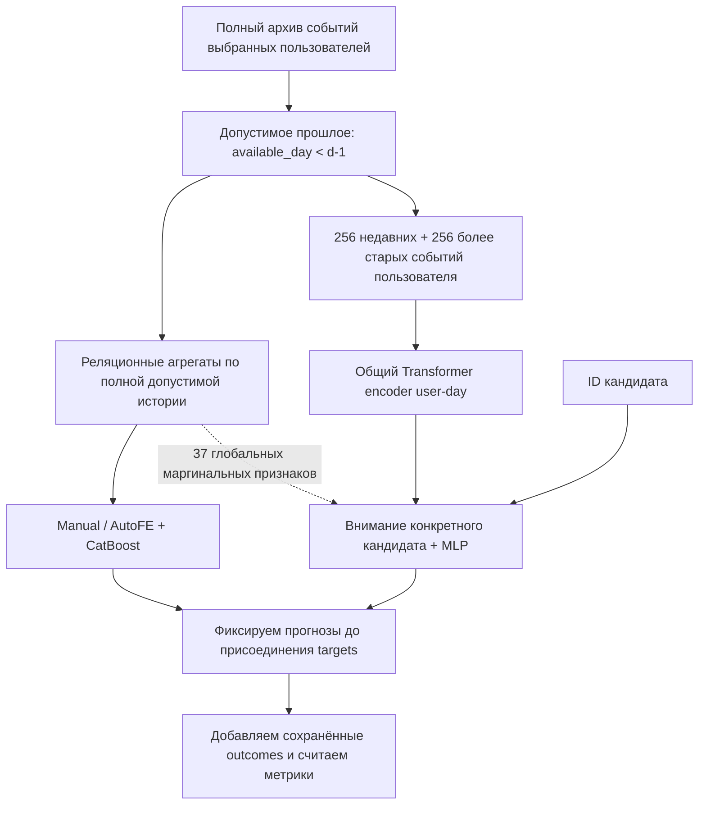

# Как устроено исследование V2 и как его объяснить

Эта памятка помогает разобраться в эксперименте, прочитать код и защитить выбранный протокол. Она описывает зафиксированный метод; итоговые значения качества нужно брать из отчёта соответствующего запуска. По устройству модели заранее нельзя заключить, что она победит CatBoost.

## 1. Что мы на самом деле предсказываем

Нам известен факт начала прослушивания трека из рекомендаций. Нужно оценить вероятность, что пользователь прослушает **не менее 50%** трека. Для каждой пары пользователь–трек за относительный день берём первое прослушивание среди всех источников, затем оставляем только события с `is_organic=0`. Цель:

`y = 1, если played_ratio_pct >= 50; иначе y = 0`.

Порядок операций важен. Если человек сначала самостоятельно запустил трек, а позже получил его в рекомендациях, нельзя вместо первого запуска выбрать более поздний удачный исход. При одинаковых timestamp используется исходный порядок записей; точнее пятисекундной детализации источник не позволяет восстановить порядок.

Это **не CTR**: у нас нет полной таблицы показов и отсутствия клика. Это также **не retrieval**: мы не выбираем один трек из всего музыкального каталога. Отрицательные примеры — реальные короткие прослушивания, а не случайные непроигранные треки. Кандидаты для дополнительной NDCG — фактически проигранные рекомендованные треки одного user-day. Такой набор известен ретроспективно, поэтому его нельзя выдавать за готовый ежедневный рекомендательный список или эффект новой политики показов.

Где смотреть: [make_v2_queries](../src/recsys_history_v2/data.py), [make_queries](../src/recsys_research/data.py).

### Почему выбран Yambda

[Yambda](https://arxiv.org/html/2505.22238v1) содержит отдельные события прослушивания, лайка, дизлайка и отмен этих действий. Это позволяет восстанавливать доступную последовательность. В [KION, §2.2](https://arxiv.org/html/2209.00325) при повторных просмотрах оставлен только последний просмотр пары user–item, а длительность агрегирована по повторениям. Все строки такого пользователя ещё не означают все его реальные действия. Для исследования временных окон и порядка событий Yambda удобнее.

Timestamp в Yambda — относительные секунды, уже округлённые до кратных пяти. Его **не нужно умножать на пять**. День вычисляется делением на 86400. Реальная календарная точка отсчёта неизвестна: из этих чисел нельзя уверенно получить понедельник или местное время суток.

## 2. Один пример временной корректности

Запрос относится к дню **200**. Дополнительный разрыв, `embargo_days`, равен одному дню. Поэтому:

```text
cutoff_day = 200 - 1 = 199
допускаются события с available_day < 199
```

Самый поздний допустимый день доступности — **198**. Для окна семь дней получаем `[199−7, 199)`, то есть **дни 192, 193, …, 198**. Это окно по времени доступности исхода, а не обещание немедленного доступа ко всем событиям с ранним timestamp.

Для прослушивания задана консервативная оценка:

```text
available_at = timestamp + ceil(track_length_seconds * played_ratio_pct / 100) + 5
available_day = available_at // 86400
```

Для остальных типов событий добавляются пять секунд. Здесь доля выше 100% **не обрезается**: повторы и перемотки требуют дополнительного времени. Например, `length=240` секунд и `ratio=150` дают `360+5=365` секунд задержки, а не 245 секунд.

Рассмотрим часы внутри условного относительного дня, без привязки к реальному часовому поясу:

| Событие | Исходное время | Когда считаем доступным | Видно запросу дня 200? |
|---|---|---|---|
| Прослушивание A: 240 секунд, 150% | День 198, 23:58:00 | День 199, 00:04:05 | Нет: available_day=199 |
| Лайк B | День 198, 23:59:00 | День 198, 23:59:05 | Да: available_day=198 |

Хотя A началось раньше B, его исход ещё не допускается в историю. Поэтому нельзя просто взять префикс по исходному timestamp. Сначала проверяем доступность каждой записи, затем упорядочиваем **уже допустимые** записи по исходному времени и source order. В коде для скорости события заранее отсортированы; маска доступности всё равно применяется к каждой записи, а не заменяется срезом timestamp-префикса.

Эта формула — явное допущение. Публичная схема не описывает полностью, означает timestamp начало или конец проигрывания и как влияют паузы. Расчёт длительности и дневной разрыв снижают риск, но не доказывают точный момент доступности production-логов.

Где смотреть: [add_availability](../src/recsys_research/data.py), [prepare_contexts](../src/recsys_history_v2/contexts.py), [build_features](../src/recsys_research/features.py).

### Как из прошлого получается числовой признак

Пусть в допустимом семидневном окне было три прослушивания данного отношения, из них два успешных. Исторический общий prior равен 0.6. Тогда:

```text
log_count = log(1 + 3) = log(4) ≈ 1.3863
smoothed_rate = (2 + 5 * 0.6) / (3 + 5) = 0.625
```

Сглаживание не позволяет двум наблюдениям выглядеть столь же надёжно, как двум тысячам. При нулевой истории rate равен prior, деления на ноль нет. Сам prior тоже считается из доступного прошлого. Временные окна для user, item и разных отношений могут описывать разные процессы; AutoFE проверяет дополнительные окна и ядра затухания на development-данных.

Ручной средний исторический ratio ограничен 100% для нормировки. У нейросети ratio представлен десятипроцентными корзинами с верхним ограничением 200%. Это ограничения **представления признака**. Ни одно из них не меняет исходную цель и не сокращает задержку доступности raw ratio.

## 3. Что значит «новая отложенная выборка»

Все 1000 пользователей V1 исключены. Зарегистрированы оставшиеся **9000 пользователей**: **1000 development** и **8000 confirmation**. Когорты выбираются по UID до анализа их исходов. По выбранным пользователям сохранены все **42 906 083 события** исходного файла; история не обрезана для ускорения обучения.

Временная схема глобальна:

| Интервал относительных дней | Пользователи, чьи строки становятся supervised-примерами | Назначение |
|---|---|---|
| 0–29 | Никто; события входят в историю | Разогрев |
| 30–209 | Обе новые когорты | Обучение весов |
| 210–239 | Только development | Гиперпараметры и early stopping |
| 240–269 | Только development | Отбор признаков и веса смеси |
| 270–300 | Только confirmation | Единственное итоговое сравнение |

Выбирается до 12 обучающих дней на пользователя, до четырёх дней для каждого development-периода и до восьми confirmation-дней. Выбор дней ограничивает только supervised queries; остальные события остаются в истории. В подготовленном наборе **1 787 611 train-строк**. Для итоговой оценки подходят **1 110 396 записей 6323 confirmation-пользователей**. Не все зарегистрированные 8000 пользователей обязательно имеют подходящий первый рекомендованный запуск в выбранном периоде.

Это преимущественно проверка будущего поведения пользователей с доступной ранней историей, а не строгий cold-start эксперимент. Ранние train-строки confirmation-когорты разрешены; её более поздние tune/select-исходы не участвуют в подборе. Не следует также обещать, что у каждого оценённого пользователя обязательно есть ранние supervised train-строки: это проверяется отдельно.

Новая когорта не означает новый календарный режим. Источник заканчивается тем же относительным днём 300. Общие шоки платформы и сезонные условия периода могут совпадать с V1. Поэтому более точный пользовательский интервал не превращается автоматически в доказательство работы в следующем месяце.

При обучении исход на границе train/tune/select должен успеть стать доступным до начала следующего этапа. Такие пограничные supervised-строки фильтруются; исходные исторические события из архива не удаляются.

Где смотреть: [choose_cohorts и make_v2_queries](../src/recsys_history_v2/data.py), [register](../src/recsys_history_v2/run.py), [конфигурация V2](../configs/v2.yaml).

## 4. Что сравнивается с AutoFE



### Ветка AutoFE

Ручной baseline содержит категории, пользовательские и объектные статистики, прямые user–item и косвенные user–artist/user–album связи. Генератор добавляет окна и экспоненциальные ядра. Importance полной development-модели задаёт порядок групп; на select перебираются несколько заранее заданных префиксов.

В V2 отбор префиксов использует **параметры и число деревьев ручного backbone**. Так различие состава признаков не смешивается внутри этого сравнения с дополнительной сменой глубины и числа деревьев. Полная all-auto семья отдельно получает ту же исходную сетку гиперпараметров. Несколько случайных подмножеств выбираются без просмотра их качества; совпадение с выбранным набором не исправляется повторной жеребьёвкой. Если доступно меньше уникальных подмножеств, это раскрывается.

Где смотреть: [train_tabular и random_group_subsets](../src/recsys_history_v2/tabular.py).

### Ветка по сырой истории

Одна history-запись содержит ID трека, исполнителя и альбома; тип события; прошлый ratio; источник трафика и возраст события. Возраст кодируется как `log1p((cutoff_day*86400 − timestamp)/86400)`, то есть относительно отсечки. Непрослушивание с отсутствующим ratio отличается от прослушивания с ratio=0. В модель не передаётся текущий исход кандидата.

Из допустимого прошлого пользователя берутся 256 последних событий и до 256 более старых событий, равномерно расставленных **по индексам старой хронологической последовательности**. Это не равномерная выборка по календарному времени и не поиск событий по будущему успеху кандидата. Дубликатов выбранных записей нет. Короткая история дополняется PAD, который маскируется.

Полный архив и вход модели — разные вещи. Если у пользователя 10 000 доступных событий, нейросеть не читает все 10 000 одновременно: её память ограничена 512 токенами. AutoFE может агрегировать все допустимые события. Сравнение оценивает способы представления при таком ограничении, а не доказывает, что обе модели получили тождественное сжатое содержимое. Доля сохранённых событий записывается в context manifest.

Для одного user-day история одинакова у всех кандидатов. Encoder обрабатывает её один раз; затем **каждый кандидат независимо** обращается к этому представлению через attention. Кандидаты не обмениваются друг с другом исходами и не посещают друг друга через self-attention. Это экономит повторное кодирование истории, сохраняя отдельный прогноз для каждого трека.

В сетке есть encoder размерности 64 и 128, два слоя и четыре головы. Feed-forward размер — четыре размерности encoder. Максимальная зарегистрированная архитектура HistoryGlobal содержит **14 517 179 обучаемых параметров**, в основном в таблицах embeddings. Она мотивирована DIN/BST, но не заявляется точным воспроизведением SASRec или HSTU. Обучается отклик на кандидата, а не оригинальная next-item задача этих моделей.

Все токены encoder уже относятся к разрешённому прошлому текущего запроса, поэтому двунаправленное внимание между ними не раскрывает будущее запроса. Вспомогательная next-action задача здесь не используется: для неё потребовался бы отдельный причинный mask по внутренним позициям. Learned null-history token обеспечивает конечный прогноз даже при пустой истории.

Где смотреть: [select_history_indices и prepare_contexts](../src/recsys_history_v2/contexts.py), [EventHistoryModel.encode_history и score_candidates](../src/recsys_history_v2/model.py), [исследовательское обоснование](../reports/v2/SEQUENCE_RESEARCH.md).

### Зачем оставлены 37 глобальных признаков

Чистая пользовательская последовательность сама по себе не видит текущую популярность или долю успешных прослушиваний объекта **у остальных пользователей**. AutoFE такую информацию использует. «Глобальные» здесь означает статистики выбранных 9000 пользователей, а не всей платформы. В основном сравнении HistoryGlobal поэтому получает общий блок из 37 признаков: по 11 item/artist/album маргинальных статистик, три тренда этих отношений и общий prior. Пользовательских и парных агрегатов в этом блоке нет.

Нормировка этого блока обучается только на train; поздние значения не меняют её mean/std. HistoryPure убирает глобальный блок. Другая абляция убирает inter-event encoder и позиционные embeddings, сохраняя внимание к отдельным событиям и их age. Она проверяет пользу смешивания событий внутри encoder; это **не удаление всей временной информации**, поскольку age остаётся.

Лайки и отмены сохраняются как разные токены. Модель может научиться учитывать их сочетания, но такая корректность не гарантирована самим названием Transformer, особенно когда часть старой истории не попала в 512 токенов. В ручных признаках likes/dislikes — накопленные количества событий, а не текущее состояние: unlike/undislike из этих счётчиков не вычитаются. Давность отношения может обновляться любым сохранённым типом события.

Где смотреть: [global_columns и prepare_global_features](../src/recsys_history_v2/trainer.py), [daily_events](../src/recsys_research/features.py).

### Почему нет словаря, обученного на будущем

ID проходят через две фиксированные hash-функции в две обучаемые таблицы, после чего их векторы складываются. Функции выбраны заранее, поэтому для нового ID не нужно смотреть частоты или каталог test-периода. Это не устраняет коллизии: разные ID могут частично делить параметры. Два банка имеют разные классы коллизий, а не просто перестановку одних и тех же bucket.

Кроме embeddings, attention получает обучаемые смещения за точное совпадение **исходных** item/artist/album ID. Это помогает различать повторное обращение к новому объекту даже при хешировании. Совпадением считается только равенство реальных ID `>=0`. Missing=`-1` и PAD=`-2` никогда не образуют ложную связь «оба неизвестны». Никакие агрегаты текущего label из такого сравнения не получаются.

Где смотреть: [DualHashEmbedding и exact_relation_matches](../src/recsys_history_v2/model.py).

## 5. Почему одна быстрая обработка дня не означает один вес дня в loss

Основной LogLoss взвешивает выбранные строки одинаково. Пусть в одном user-day одна строка с loss=0.2, а в другом девять строк с loss=0.8 каждая. Тогда:

```text
среднее по строкам = (0.2 + 9 * 0.8) / 10 = 0.74
среднее по дням    = (0.2 + 0.8) / 2       = 0.50
```

Это разные целевые функции. Поэтому trainer суммирует BCE всех настоящих candidate-строк в пакете и делит на постоянное ожидаемое число строк пакета, `N_train / число_пакетов`. Он не делит каждый пакет на собственное число строк: иначе маленькие user-day пакеты получили бы повышенный вес. PAD в loss не участвует. Перемешиваются user-day группы, а не разрушается соответствие кандидатов общей истории.

В одной из заранее заданных конфигураций есть pairwise auxiliary loss: успешный трек должен иметь logit выше коротко прослушанного трека в той же наблюдённой группе. Пары выбираются из настоящих train-исходов. Это выборка **пар для loss**, а не создание искусственных отрицательных объектов каталога. Основным критерием выбора конфигурации всё равно остаётся tune LogLoss; вспомогательная ranking-цель не гарантирует улучшения NDCG.

Где смотреть: [fit_history и pairwise_sum](../src/recsys_history_v2/trainer.py), [проверки нормировки](../tests/test_v2_trainer.py).

### Три seed — это три обучения, а не три независимых датасета

Для основных сравниваемых семей зафиксированы seed `17, 29, 43`. Итоговая вероятность — среднее их вероятностей. Это не среднее метрик и не выбор лучшего seed по test. Контрольные neural-абляции имеют отдельно заданный меньший seed-бюджет; их нельзя выдавать за столь же устойчиво настроенные основные семьи.

Например, при `y=1` два прогноза 0.9 и 0.1 имеют средний LogLoss около 1.204. Средняя вероятность равна 0.5, её LogLoss — около 0.693. Операции «усреднить прогнозы» и «усреднить LogLoss» не переставляются. Метрики ранжирования и ROC-AUC тоже нелинейны.

Где смотреть: [mean_history](../src/recsys_history_v2/run.py), [финальное ансамблирование CatBoost](../src/recsys_history_v2/tabular.py).

## 6. Что означает интервал сравнения

Заранее основным сравнением выбрано:

`Δ = LogLoss(HistoryGlobal) − LogLoss(Selected AutoFE)`.

Отрицательное значение благоприятно для history-модели. Для 95% интервала 5000 раз выбираются пользователи с возвращением; все строки каждого выбранного пользователя переносятся вместе. Обе модели получают **одних и тех же выбранных пользователей** в каждом повторе. Это сохраняет парность сравнения и не делает повторные прослушивания одного человека независимыми наблюдениями.

Для LogLoss внутри выбранной пользовательской совокупности сохраняются веса строк. Для user-macro NDCG сначала усредняются подходящие дни пользователя, затем равномерно пользователи. Смешанные дни содержат оба исхода; в полностью положительной группе NDCG тривиально равна единице, в группе без положительных исходов она не определена. Такие группы и покрытие показываются отдельно. При равных score используется ожидаемый gain случайного разрешения ничьей, поэтому константа не выигрывает от порядка label в файле.

Bootstrap условен на обученные модели и наблюдавшийся временной период. Он не повторяет обучение и feature selection внутри каждого resample. Дополнительная проверка по круговым блокам дней длины 3 и 7 проверяет чувствительность к общим временным колебаниям. Это **не совместный двухмерный user/time интервал**, не перенос на новый месяц и не замена основного пользовательского интервала. Доля resample с улучшением не является p-value или апостериорной вероятностью.

Если основной интервал включает ноль, направление эффекта остаётся неопределённым в рамках этого дизайна. Если целиком ниже нуля, это свидетельство в пользу history-модели при данных условиях. Из вторичных сравнений и exploratory-срезов нельзя задним числом выбрать новый основной результат.

Где смотреть: [paired_user_bootstrap и evaluate](../src/recsys_research/metrics.py), [temporal_sensitivity](../src/recsys_history_v2/statistics.py).

## 7. Что фиксируется до открытия итоговых targets

1. **Registration:** конфигурация, список исключённых пользователей, новые когорты и основной вопрос записываются до подбора.
2. **Preparation:** исходные файлы проверяются по SHA256; сохраняются признаки и контексты с cutoff. У test-строк в общей query-таблице `label=NaN`; ratio, duration и outcome-derived availability текущего запроса туда не переносятся. Outcomes лежат отдельно.
3. **Selection:** подбор использует разрешённые train/tune/select-строки. Сохраняются параметры, эпохи, составы признаков, seed и SHA256 каждого файла модели и исходников. Вес смеси AutoFE/history определяется только на select.
4. **Blind prediction:** сначала вычисляются все финальные вероятности. Проверяются форма, конечность и диапазон. Сохраняются `blind_predictions.parquet` без labels и `prediction_lock.json`, связывающий их с selection lock.
5. **Release:** только после этого читается отдельная таблица outcomes. Ключи `uid, item_id, day, group_id` должны совпасть точно. Прогнозы не меняются при добавлении labels. Затем считаются метрики и интервалы.
6. **Audit:** независимо пересчитываются метрики, сверяются хеши и NDCG со sklearn; при наличии файлов перезагружаются модели. GPU/BF16 replay сохраняет полный исходный первый batch, чтобы изменение формы вычислений не маскировать расширением допуска.

Повторный evaluate после существующего prediction lock или готового результата блокируется. Изменение весов, исходников или данных между стадиями также обнаруживается. Аудитор не делает refit и не подбирает новый вариант.

Это процедурная защита, а не криптографическое сокрытие публичных данных. Полный raw-журнал содержит и поздние события: без них нельзя честно обновлять историю более поздних test-дней. Защита состоит в проверяемом cutoff и отсутствии использования confirmation-targets при выборе решения, а не в утверждении, что будущих байтов вообще нет на диске. Хеши подтверждают идентичность файлов, но сами по себе не доказывают правильность математической постановки или время появления исхода в реальном сервисе.

Где смотреть: [register, search и evaluate_locked](../src/recsys_history_v2/run.py), [audit_v2_results.py](../scripts/audit_v2_results.py), [проверки границ протокола](../tests/test_v2_pipeline.py).

## 8. Десять вероятных вопросов на защите

**1. Почему это рекомендательные системы, если предсказывается дослушивание?**  
Это ranking/response-задача для конкретного user–item кандидата. Рекомендация уже породила запуск, мы моделируем качество последующего отклика. В работе не заявляется качество извлечения объектов из полного каталога. См. [make_v2_queries](../src/recsys_history_v2/data.py).

**2. Не попало ли само прослушивание в его признаки?**  
Нет в рамках заданной модели доступности: текущий запрос дня `d` видит только `available_day < d−1`. Его собственный исход, события текущего дня и ещё не завершившиеся прошлые прослушивания не допускаются. Реальную задержку логирования мы отдельно оговариваем как допущение. См. [add_availability](../src/recsys_research/data.py), [prepare_contexts](../src/recsys_history_v2/contexts.py).

**3. Почему confirmation-пользователи участвуют в train?**  
Проверяется будущее поведение пользователей, для которых ранняя информация доступна. Их ранние targets разрешены; их поздние confirmation-labels не управляют выбором модели. Это другой вопрос, чем cold-start на полностью невиданных пользователях. См. [make_v2_queries](../src/recsys_history_v2/data.py).

**4. Зачем два validation-периода?**  
Tune выбирает гиперпараметры и эпоху; select выбирает расширение признаков и вес смеси. Подбирать всё на одном маленьком интервале легче переобучить. Разделение снижает риск, но не устраняет шум выбора и не заменяет confirmation. См. [search](../src/recsys_history_v2/run.py).

**5. Сохранилась ли полная история, если Transformer получает 512 событий?**  
Архив не урезан. Ограничен вход конкретной модели: 256 недавних и до 256 распределённых старых событий. Это вычислительная компрессия; она может потерять важные повторения. Её покрытие нужно читать в context manifest. См. [select_history_indices](../src/recsys_history_v2/contexts.py).

**6. HistoryGlobal всё же использует ручные признаки — разве сравнение честное?**  
37 общих глобальных маргинальных признаков сохранены, чтобы пользовательский encoder не проигрывал только из-за отсутствия информации о других пользователях. Он заменяет персональные агрегаты обучаемой историей. HistoryPure отдельно проверяет отказ от этого блока. См. [global_columns](../src/recsys_history_v2/trainer.py).

**7. Хеширование ID не превращает разные треки в один?**  
Коллизии возможны и раскрыты. Два различных hash-банка уменьшают совпадение полных представлений. Точные match-gates сравнивают исходные ID; два missing не считаются совпадением. В отличие от одного UNK, новый ID не теряет всю идентичность. См. [DualHashEmbedding](../src/recsys_history_v2/model.py).

**8. Может ли LogLoss улучшиться, а NDCG ухудшиться?**  
Да. Более точная общая вероятность дослушивания пользователя не обязательно лучше упорядочивает треки внутри его дня. Отличаются и веса: строки против user-day/user-macro. Поэтому основной критерий фиксируется заранее, а остальные метрики не скрываются. См. [evaluate](../src/recsys_research/metrics.py).

**9. Как учтены unlike и undislike?**  
В raw-history это отдельные токены, которые encoder может связать с предшествующими действиями. В ручных cumulative counts отмена не вычитается. Ни один вариант не объявляется точным автоматом текущего состояния предпочтения; truncation тоже может убрать нужную раннюю запись. См. [EVENT_TYPES](../src/recsys_history_v2/contexts.py), [daily_events](../src/recsys_research/features.py).

**10. Почему недостаточно одной красивой метрики и зачем большой GPU?**  
Нужны единые кандидаты, cutoff, новый confirmation, интервалы, seed-разброс и измеренная стоимость. GPU позволяет обучить серию history-моделей; он не гарантирует выигрыш и сам по себе не ускоряет pandas-агрегаты. Архитектура этого масштаба не требует H100 по определению; важны также CPU RAM и объём полного журнала. См. [конфигурацию](../configs/v2.yaml), [модель](../src/recsys_history_v2/model.py), [аудитор](../scripts/audit_v2_results.py).
