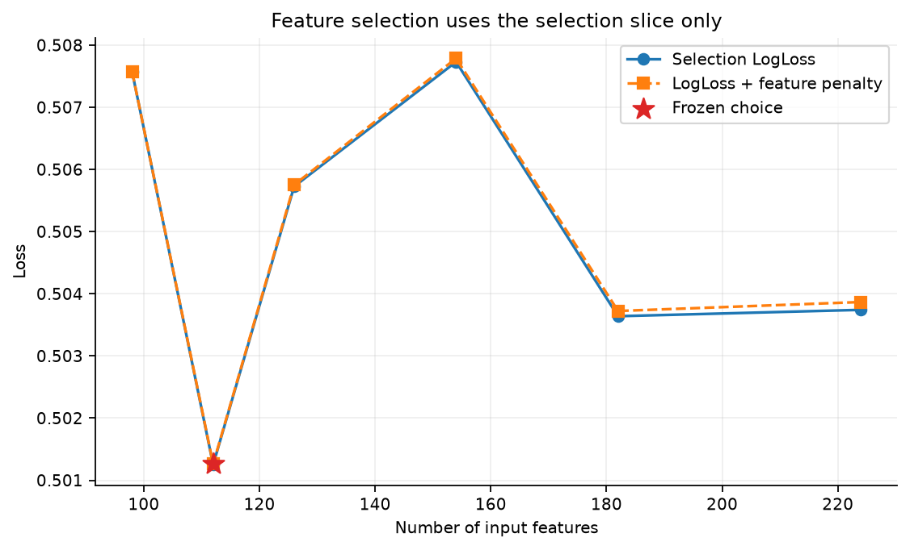
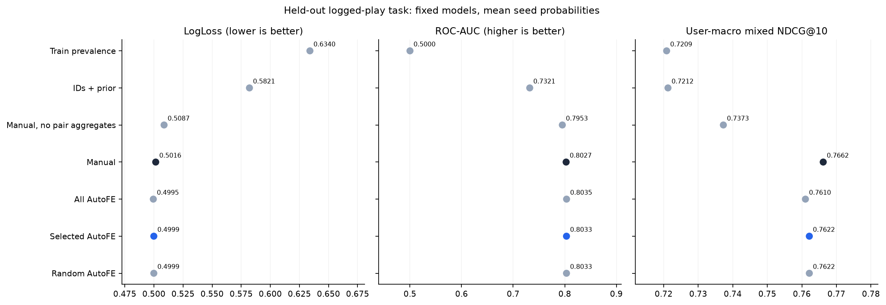
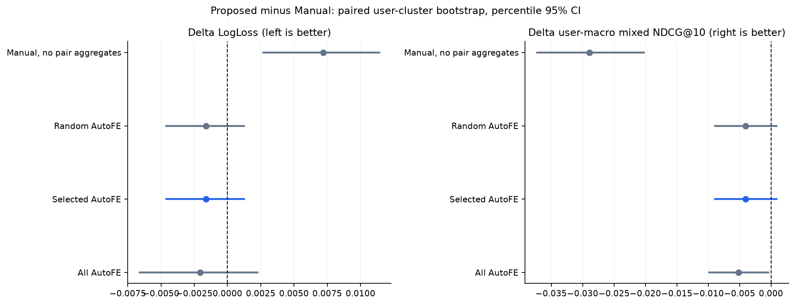
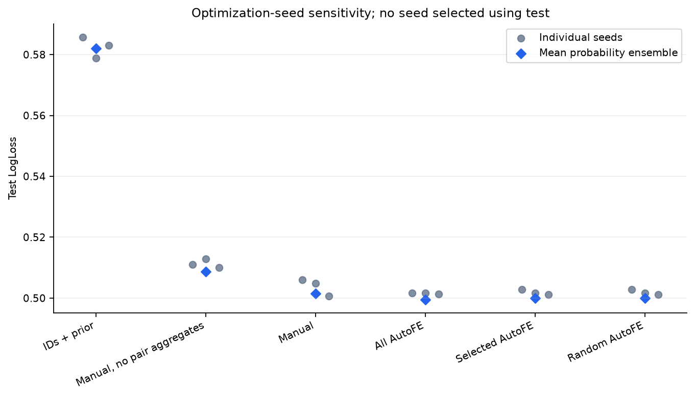
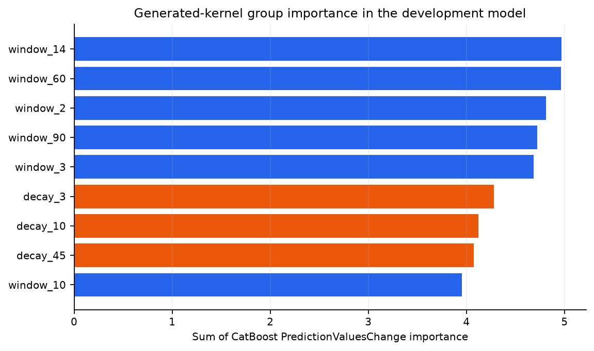
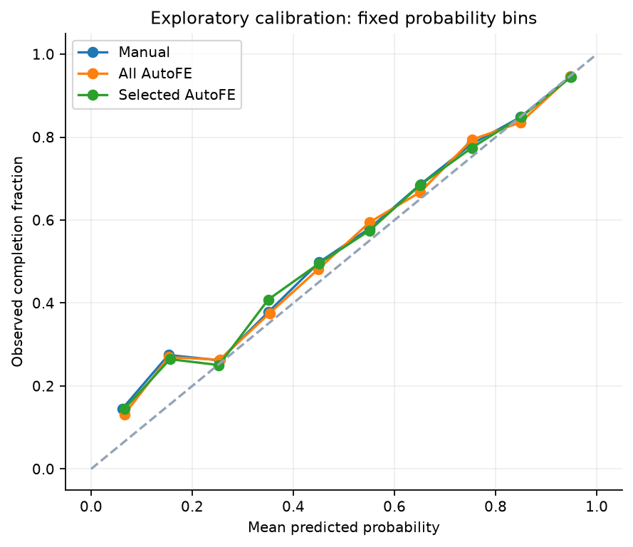
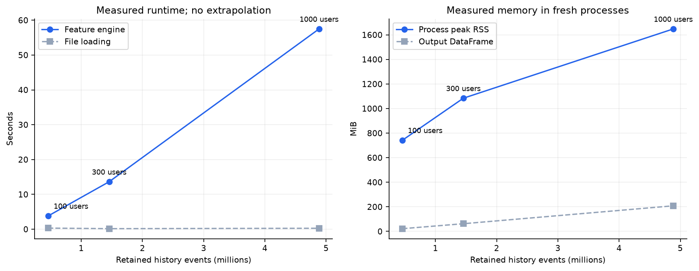

# Автоматический поиск временных признаков для рекомендательных систем

## Результат и исследовательский вопрос

Проверяем, может ли ограниченная автоматически порождённая грамматика временных агрегатов улучшить сильный CatBoost на содержательных ручных признаках. Объект исследования — **вероятность дослушивания уже начатого рекомендованного трека**, а не извлечение объектов из полного каталога и не CTR. Отрицательные примеры — реальные короткие прослушивания; искусственное negative sampling не используется.

Надёжное улучшение над manual этим экспериментом не продемонстрировано: точечный test LogLoss выбранного AutoFE ниже на 0.001623 (0.324% относительно manual). Парный пользовательский bootstrap даёт 95% интервал ΔLogLoss [-0.0046078; 0.0012471]. Интервал включает ноль, поэтому направление эффекта при повторной выборке пользователей этой популяции остаётся неопределённым. Изменение вторичной user-macro NDCG@10 на смешанных днях: -0.0040241. Её 95% интервал [-0.0089173; 0.0008930] также включает ноль.

**Ограничение случайного контроля:** selected_auto и random_auto получили один и тот же набор групп; этот запуск не позволяет показать преимущество отбора над случайным выбором. Подробности — в разделе 4.

Это воспроизводимый CPU-эксперимент на 1 000 случайно выбранных пользователях Yambda-50M: сохранено **4 884 366 событий** их доступной истории. Выбор модели завершён до единственного финального сравнения на test. Все числа ниже прочитаны из сохранённых артефактов; код отчёта не обучает и не выбирает модели.

## 1. Почему эти данные и эта постановка

[Yambda](https://arxiv.org/html/2505.22238v1) содержит последовательности прослушиваний, лайков, дизлайков и отмен этих действий; доступны связи track–artist и track–album. В отличие от него, [KION](https://arxiv.org/html/2209.00325) оставляет последний просмотр каждой пары user–item и суммирует длительность по повторным просмотрам. Для исследования истории повторного потребления Yambda даёт более прямую постановку. Выбираем подмножество пользователей Yambda-50M; выводы не переносятся автоматически на всю аудиторию сервиса.

Для каждого user–item в условном дне сначала выбирается **первое** прослушивание среди всех источников трафика: порядок timestamp, затем исходный порядок записи при совпадении timestamp. После этого оставляем только `is_organic == 0`. Поэтому более ранний органический запуск не позволяет выбрать вместо него поздний успешный рекомендованный запуск того же трека. Цель `label = 1[played_ratio_pct >= 50]`. Порог «не менее 50%» и допустимость значений выше 100% подтверждены [авторами датасета](https://huggingface.co/datasets/yandex/yambda/discussions/10). Значения выше 100 означают повторное прослушивание участков, а не автоматически ошибочную запись.

Текущие `played_ratio_pct`, `track_length_seconds`, timestamp внутри дня и текущий outcome **не входят в матрицу модели**. Условие рекомендованного трафика задаёт исследуемую популяцию. История признаков содержит и органические, и рекомендованные события. ID пользователя, трека, выбранного исполнителя и альбома считаем доступными при начале проигрывания.

Для классификации каждая выбранная запись — отдельный пример с естественной долей дослушиваний. Для дополнительного ранжирования кандидатами служат фактически проигранные рекомендованные треки из одного выбранного user-day. Этот набор известен ретроспективно и не является доступным в начале дня рекомендательным slate. Его NDCG характеризует только **условное переупорядочивание наблюдавшихся запусков**. Нет оснований называть его качеством retrieval, будущим online uplift или качеством на всём каталоге. Проблемы sampled-метрик обсуждаются в [Krichene & Rendle, 2020](https://research.google/pubs/on-sampled-metrics-for-item-recommendation/); в нашей постановке выборка отрицательных объектов вообще не конструируется, но остаётся смещение исходной logging policy.

## 2. Выборка и время

Источник: `yandex/yambda sequential/50m`, фиксированная ревизия `dd6f3a19eef5866e346c3270e098baa641a44948`. Из 10 000 пользователей равномерно без возвращения выбираются 1 000, seed `2026`; активность и целевые значения не участвуют в выборе. По каждому выбранному пользователю сохраняются **все имеющиеся в исходном файле события**. Число объектов в сохранённой истории — 265 648. Длины историй: минимум 11, медиана 2730.5, p90 13360.9, максимум 27 578 событий.

Распределение типов событий: `listen`: 4 764 064, `like`: 80 258, `unlike`: 27 291, `dislike`: 10 810, `undislike`: 1 943. История не урезается по числу последних событий. Для ограничения CPU-бюджета равномерно выбираются **дни supervised-примеров** отдельно для каждого пользователя и каждого временного split, seed `1701`: train: до 6, tune: до 2, select: до 2, test: до 3. Выбираются дни, в которых вообще есть подходящие запуски, без обращения к outcome; все подходящие первые проигрывания выбранного дня сохраняются. Это меняет распределение supervised-дней, поэтому оценка относится именно к описанному дизайну выборки.

Timestamp — **относительные секунды, уже округлённые до кратного пяти**, а не число пятисекундных интервалов. Дни вычисляются `timestamp // 86400`. Начало времени анонимизировано: это не календарная дата, не локальный часовой пояс и не реальный день недели. История разогрева — дни `0…29`; train — `30…209`; tune — `210…239`; select — `240…269`; test — `270…300`. Разбиение глобально по времени, а не по последнему событию каждого пользователя. Это учитывает риск пересечения временных границ, описанный в [работе об утечках в офлайн-рекомендациях](https://arxiv.org/abs/2010.11060) и [TimeSplit](https://arxiv.org/abs/2507.16289).

| Split | Дни с примерами | Пользователей | User-day | Строк | Доля y=1 | Медиана кандидатов | p90 кандидатов |
| --- | --- | --- | --- | --- | --- | --- | --- |
| train | 30–209 | 723 | 3 962 | 108 373 | 0.6597 | 15.0 | 65.0 |
| tune | 210–239 | 645 | 1 229 | 33 351 | 0.6859 | 15.0 | 67.2 |
| select | 240–269 | 697 | 1 337 | 32 942 | 0.6571 | 13.0 | 60.4 |
| test | 270–300 | 784 | 2 176 | 58 214 | 0.6706 | 14.0 | 63.0 |

Недостаточно ограничить timestamp признаков: target на границе периода тоже должен успеть стать известным. Поэтому supervised-исходы train/tune/select допускаются только при `available_at < начало следующего split`. Purge выполняется **до выбора supervised-дней**; число удалённых записей из исходного подходящего пула: train: 3, tune: 7, select: 4, test: 0. Эти счётчики не означают, что столько строк удалили из уже выбранных дней. Исторические события при этом не удаляются, их использование по-прежнему зависит от доступности. Для финального test следующего этапа выбора модели нет.

### Доступность outcome и причинность признаков

Для прослушивания используется консервативная оценка `available_at = timestamp + ceil(track_length_seconds * played_ratio_pct / 100) + 5`; для остальных событий — `timestamp + 5`. При расчёте задержки отношение **не ограничивается 100%**, поскольку повторы требуют времени. `available_day = available_at // 86400`. Запрос дня `d` видит только записи с `available_day < d - 1`: действует дополнительный embargo. Агрегаты не используют цель текущего запроса, события того же дня, равные граничные дни и будущие доступные outcome. В окнах и затухании отсчитывается время доступности, а не неизвестное время публикации результата.

Это явное инженерное предположение о доступности, **не доказательство точной задержки production-логов**. Публичная схема не устанавливает однозначно, обозначает ли timestamp начало или конец прослушивания, а наблюдаемая доля не полностью описывает wall-clock паузы. Рассчитанная длительность и дополнительный дневной разрыв уменьшают этот риск; отдельный эксперимент с другим embargo здесь не проведён.

На test веса моделей зафиксированы, но историческое состояние обновляется: события более ранних test-дней могут попасть в признаки последующих test-дней после выполнения availability и embargo. Это rolling online-history evaluation без переобучения, а не эксперимент с историей, замороженной в конце train. Состояние считается по всем сохранённым событиям, включая дни, которые не выбраны как supervised-примеры.

Метаданные artist/album считаются статическими и известными при запросе; время фактической публикации этих связей не дано. При нескольких значениях выбирается минимальный числовой ID, независимо от популярности и outcome. Это воспроизводимое упрощение many-to-many структуры, которое теряет часть коллабораций и альбомных связей. Отсутствующее значение кодируется `-1` и не создаёт общую ложную аффинность между разными треками. Подробные пропуски и множественность записаны в `manifest.json`.

## 3. Сильный ручной baseline

Модель — [CatBoost](https://proceedings.neurips.cc/paper/2018/hash/14491b756b3a51daac41c24863285549-Abstract.html), binary LogLoss, категориальные ID, `has_time=True`, максимум CTR-комбинаций 1. Пользователь–объект связи не подменяются только популярностью: ручной набор содержит отношения `user`, `item`, `artist`, `album`, `user_item`, `user_artist`, `user_album`.

Для каждого отношения считаются `log1p(count)` и сглаженная доля дослушиваний за 7 дней, 30 дней и всю доступную историю; давность последнего доступного события; средняя историческая доля прослушанного; доля органических прослушиваний; количества лайков и дизлайков. Для парных связей добавляются доли в активности пользователя, для всех отношений — отношение короткой к длинной активности. Общий prior дослушиваний тоже вычисляется только из доступного прошлого; сглаживание `(positive + 5*prior)/(count + 5)` использует фиксированный prior weight 5. В среднем отношении историческая доля прослушивания ограничена 100%; эта нормировка не меняет исходную цель.

Лайки/дизлайки — накопленные количества событий, а не актуальное состояние предпочтения: `unlike`/`undislike` не вычитаются. Они сохранены в исходной истории, но не получают отдельной outcome-статистики. Давность отношения может обновляться по любому из сохранённых типов событий. Это осознанное ограничение грамматики. Нет SVD/нейронных эмбеддингов и аудио: сравнение изолирует генерацию временных агрегатов.

До удаления постоянных на train столбцов в manual 98 признаков; в фактически обученном baseline 98. Дополнительные контроли: константа с долей положительного класса на train; CatBoost только с ID и историческим global prior; manual без агрегатов трёх парных отношений (с сохранением категориальных ID). Эти модели оцениваются на тех же строках и кандидатах.

## 4. AutoFE: ограниченная грамматика и проверяемый отбор

Предлагаемый вклад — адаптация известной идеи порождения и отбора признаков к строго временному multi-event логу, а не заявление об изобретении AutoFE или causal discovery. [Deep Feature Synthesis](https://dai.lids.mit.edu/wp-content/uploads/2017/10/DSAA_DSM_2015.pdf) систематизирует relational-примитивы; [ExploreKit](https://people.eecs.berkeley.edu/~dawnsong/papers/icdm-2016.pdf) объединяет генерацию и отбор; [OpenFE](https://proceedings.mlr.press/v202/zhang23ay.html) показывает пользу эффективной генерации и фильтрации табличных признаков. Здесь пространство намеренно мало, задано кодом и полностью просматриваемо.

Грамматика: **7 отношений × 2 статистики × 9 временных ядер = 126 дополнительных столбцов до фильтра постоянных признаков**. Статистики — `log1p(count)` и сглаженная доля дослушиваний. Box-окна: 2, 3, 10, 14, 60, 90 дней. Экспоненциальные ядра: периоды полураспада 3, 10, 45 дней, вес события `2^(-(cutoff-available_day)/half_life)`. Группа — одно ядро сразу по семи отношениям и двум статистикам; это 14 потенциальных признаков и ограничение размера поиска, а не произвольный перебор SQL.

Алгоритм:

1. Удалить признаки, постоянные **на train**. Для manual и manual+all_auto независимо перебрать одинаковую сетку из 3 конфигураций на tune. Максимум 500 деревьев, early stopping 50; seed для поиска `17`. Гиперпараметры: `[{"depth": 5, "learning_rate": 0.06, "l2_leaf_reg": 5}, {"depth": 7, "learning_rate": 0.06, "l2_leaf_reg": 5}, {"depth": 6, "learning_rate": 0.1, "l2_leaf_reg": 10}]`. В журнале сохранено 6 tune-запусков.
2. В выбранной all_auto модели суммировать CatBoost feature importance по группам. Модель обучена на train; её параметры и число деревьев определены tune. Select/test не участвуют в построении этого порядка.
3. На select сравнить manual и заранее заданные префиксы порядка групп. Критерий `LogLoss + 1e-06 * число дополнительных признаков`; при равенстве предпочесть меньшее число столбцов. Параметры и число деревьев для непустых префиксов наследуются от all_auto; префиксы не получают отдельную настройку.
4. Сохранить `selection_lock.json`: список столбцов, группы, параметры, seed, конфигурацию и хеши исходников. В зафиксированном журнале `n_test_rows_used = 0`. Только после этого запускать предписанные финальные модели на test. Train не объединяется с tune/select при финальном обучении.

| Число групп | Столбцов | Select LogLoss | Select objective | Время fit, с | Группы |
| --- | --- | --- | --- | --- | --- |
| 0 | 98 | 0.507570 | 0.507570 | 0.0 | manual |
| 1 | 112 | 0.501249 | 0.501263 | 23.4 | window_14 |
| 2 | 126 | 0.505725 | 0.505753 | 29.9 | window_14, window_60 |
| 4 | 154 | 0.507731 | 0.507787 | 29.4 | window_14, window_60, window_2, window_90 |
| 6 | 182 | 0.503639 | 0.503723 | 33.9 | window_14, window_60, window_2, window_90, window_3, decay_3 |
| 9 | 224 | 0.503741 | 0.503867 | 0.0 | window_14, window_60, window_2, window_90, window_3, decay_3, decay_10, decay_45, window_10 |

Выбрано: **window_14**. Итоговые параметры: `{"depth": 7, "learning_rate": 0.06, "l2_leaf_reg": 5}`, деревьев `396`. Random-control использует один фиксированный случайный порядок групп, seed `8821`, и такое же число групп: `window_14`. Это **один случайный контроль**, не распределение по многим случайным поискам; число фактически непостоянных столбцов нужно сравнивать по таблице результатов. При непустом наборе его параметры наследованы от all_auto; при нуле групп он наследует manual, включая число деревьев.

**Совпадение случайного контроля.** Фиксированный случайный порядок с seed `8821` случайно дал те же группы, что и отбор: `window_14`. Контроль и seed не изменялись после обнаружения совпадения. Совпадают упорядоченные списки столбцов, параметры, число деревьев и фиксированные seeds обучения, поэтому ожидаются одинаковые вероятности; максимальное абсолютное отличие сохранённых прогнозов: `0`. Этот запуск не различает качество содержательного отбора и одного случайного выбора. Совпадение также не доказывает, что поиск бесполезен: независимый random-control для такого вывода здесь отсутствует; нужны заранее запланированные дополнительные случайные порядки.



Отбор по importance не гарантирует оптимум: коррелированные окна делят важность, префиксный поиск не рассматривает все комбинации, а feature penalty выбран заранее как инженерное ограничение. Больший диапазон пространства и иной бюджет могли бы изменить результат. Все отклонённые префиксы сохранены; нет скрытого поиска по test.

## 5. Итоговое качество на test

Главная метрика — **LogLoss** на наблюдённых запусках. ROC-AUC, Brier и Average Precision дополняют её; они не заменяют основной критерий после просмотра результатов. Для каждой CatBoost-модели обучены 3 фиксированных seeds `[17, 29, 43]`; таблица показывает метрики среднего их вероятностей. Константа не ансамблируется. Ансамбль использует одинаковое число запусков для сравниваемых моделей; отдельно ниже показана чувствительность одиночных запусков.

| Модель | Признаки | LogLoss ↓ | ROC-AUC ↑ | Brier ↓ | AP ↑ | NDCG@10 mixed ↑ | User-macro NDCG mixed ↑ | Recall@10 mixed ↑ |
| --- | --- | --- | --- | --- | --- | --- | --- | --- |
| Константа train | 0 | 0.634020 | 0.500000 | 0.221015 | 0.670595 | 0.711654 | 0.720853 | 0.546424 |
| CatBoost: ID + prior | 5 | 0.582073 | 0.732124 | 0.199830 | 0.842096 | 0.712806 | 0.721246 | 0.546830 |
| Manual без парных агрегатов | 53 | 0.508735 | 0.795276 | 0.169008 | 0.883201 | 0.730855 | 0.737276 | 0.558436 |
| Manual CatBoost | 98 | 0.501551 | 0.802654 | 0.165874 | 0.886799 | 0.761477 | 0.766181 | 0.573977 |
| Manual + все AutoFE | 224 | 0.499487 | 0.803504 | 0.165213 | 0.887334 | 0.757909 | 0.761032 | 0.571576 |
| Manual + отбор AutoFE | 112 | 0.499929 | 0.803344 | 0.165567 | 0.887788 | 0.758567 | 0.762157 | 0.572688 |
| Manual + случайные группы | 112 | 0.499929 | 0.803344 | 0.165567 | 0.887788 | 0.758567 | 0.762157 | 0.572688 |



### Покрытие и смысл ранжирования

Test: 58 214 строк, 784 пользователей, 2 176 user-day. Групп хотя бы с двумя кандидатами: 1 907; смешанных по target: 1 410 (64.8% всех групп), пользователей со смешанными группами: 681. Полностью положительных групп: 333; без положительных: 164; singleton: 269. Последние три счётчика относятся к разным явно заданным случаям: all-positive/no-positive считаются только при размере ≥2, singleton отдельно.

`NDCG mixed` и `Recall mixed` сначала усредняются по смешанным user-day. `User-macro NDCG mixed` сначала усредняет дни внутри каждого подходящего пользователя, затем пользователей. Полностью положительные дни имеют тривиальный NDCG=1, поэтому основной ranking-диагностикой служат смешанные дни. Без положительных recall и NDCG не определены и исключаются, а не превращаются в ноль. Дополнительные `ndcg_all_defined`/`recall_all_defined` со всеми положительно определёнными группами сохранены в JSON. Это **условные метрики на покрытой части лога**; отбор mixed-групп не используется для основной классификации и не означает качество на всех пользователях.

NDCG реализован отдельно и проверен тестами на известных примерах и сравнением со scikit-learn. При одинаковых score используется математическое ожидание gain по всем перестановкам tie-блока, включая границу K; порядок строк и target не разрешают ничьи в пользу модели. Для Recall применяется то же правило. Это особенно существенно для константной модели.

### Неопределённость: парный bootstrap по пользователям

| Модель против manual | Метрика | Δ = модель − manual | 95% percentile CI | Доля bootstrap с улучшением |
| --- | --- | --- | --- | --- |
| Manual + все AutoFE | LogLoss | -0.0020644 | [-0.0066015; 0.0022542] | 0.835 |
| Manual + все AutoFE | user-macro NDCG mixed | -0.0051485 | [-0.0098437; -0.0004483] | 0.017 |
| Manual + отбор AutoFE | LogLoss | -0.0016226 | [-0.0046078; 0.0012471] | 0.847 |
| Manual + отбор AutoFE | user-macro NDCG mixed | -0.0040241 | [-0.0089173; 0.0008930] | 0.050 |
| Manual + случайные группы | LogLoss | -0.0016226 | [-0.0046078; 0.0012471] | 0.847 |
| Manual + случайные группы | user-macro NDCG mixed | -0.0040241 | [-0.0089173; 0.0008930] | 0.050 |
| Manual без парных агрегатов | LogLoss | 0.0071841 | [0.0027020; 0.0114065] | 0.002 |
| Manual без парных агрегатов | user-macro NDCG mixed | -0.0289050 | [-0.0372512; -0.0202573] | 0.000 |

В каждом из 2000 bootstrap-повторов с возвращением выбираются **пользователи целиком**, сохраняя все их test-строки и дни. Для LogLoss сохраняется вес строк, для user-macro NDCG — равный вес подходящих пользователей. При LogLoss улучшение — Δ<0, при NDCG — Δ>0. Доля bootstrap-повторов с улучшением описывает эмпирическое распределение; это **не p-value и не апостериорная вероятность**. Интервалы условны на уже обученных и выбранных моделях: повторного обучения и повторения feature selection внутри bootstrap нет. Они не учитывают весь риск выбора модели и смещения logging policy. Здесь не проводится корректировка за множественные вторичные сравнения.



### Чувствительность к seed

| Модель | LogLoss каждого seed | Среднее ± SD LogLoss одиночных моделей | Среднее ± SD ROC-AUC одиночных моделей |
| --- | --- | --- | --- |
| CatBoost: ID + prior | 17: 0.585751, 29: 0.578841, 43: 0.583043 | 0.582545 ± 0.003482 | 0.731714 ± 0.002436 |
| Manual без парных агрегатов | 17: 0.510971, 29: 0.512888, 43: 0.510014 | 0.511291 ± 0.001463 | 0.792978 ± 0.001442 |
| Manual CatBoost | 17: 0.506007, 29: 0.504873, 43: 0.500579 | 0.503820 ± 0.002863 | 0.800730 ± 0.002608 |
| Manual + все AutoFE | 17: 0.501618, 29: 0.501586, 43: 0.501269 | 0.501491 ± 0.000193 | 0.801771 ± 0.000167 |
| Manual + отбор AutoFE | 17: 0.502902, 29: 0.501639, 43: 0.501108 | 0.501883 ± 0.000922 | 0.801746 ± 0.000924 |
| Manual + случайные группы | 17: 0.502902, 29: 0.501639, 43: 0.501108 | 0.501883 ± 0.000922 | 0.801746 ± 0.000924 |

SD — выборочное стандартное отклонение по фиксированным seeds оптимизации; это не доверительный интервал по пользователям. Метрика ансамбля не обязана равняться среднему метрик отдельных моделей. Ни один seed не выбран по test.



## 6. Что объясняет результат

Manual+all_auto меняет LogLoss относительно manual на **-0.0020644**. Отбор по select меняет его на **-0.0016226**, а выбранный набор относительно случайного контроля — на **0.0000000**. Эти различия надо читать вместе с пользовательскими интервалами и seed-разбросом; одно лучшее число не доказывает универсальное преимущество отбора. Удаление агрегатов user–item, user–artist и user–album из ручной модели изменяет LogLoss на 0.0071841; положительное значение означает пользу этих агрегатов в данном обучении. Категориальные ID остаются, и CatBoost может обучать взаимодействия между ними. Эта абляция наследует параметры manual и не оценивает оптимально перенастроенную модель без парных агрегатов.

На select изменение LogLoss выбранного набора относительно manual было -0.0063211, на test — -0.0016226. Точечный выигрыш сократился при переходе к более позднему периоду. Возможные объяснения — шум выбора лучшего из нескольких префиксов (winner's curse), временное изменение поведения и состава активных пользователей, а также отбор по одному seed при итоговом ансамбле. Это гипотезы, а не установленные причины; разделённые tune/select уменьшают, но не устраняют риск переобучения процедуры на validation. В select было 697 пользователей и доля дослушиваний 0.6571, в test — 784 и 0.6706; это свидетельство различия наблюдённых периодов, а не доказательство причины уменьшения эффекта.

LogLoss и ranking отвечают на разные вопросы. LogLoss взвешивает строки, включая различия склонности пользователей к дослушиванию; user-macro NDCG рассматривает порядок треков внутри пользователя/дня и равномерно взвешивает покрытых пользователей. В полной development-модели сумма importance `cat_uid` и непарных `user__*` составляет 76.43 из 100. Эти признаки сами по себе постоянны внутри user-day, хотя модель может использовать их взаимодействия с объектами. Это согласуется с гипотезой, что дополнительные временные ядра точнее описывают общую склонность к дослушиванию, не обязательно улучшая порядок треков. Importance не доказывает механизм, а калибровка, discrimination и внутригрупповой порядок не тождественны. У all_auto Δ user-macro NDCG = -0.0051485, 95% интервал [-0.0098437; -0.0004483]. Весь этот вторичный интервал лежит ниже нуля: более низкий точечный LogLoss здесь сопровождается ухудшением условного ranking. Интервал не скорректирован за множественные вторичные сравнения.

Минимальный наблюдённый test LogLoss среди предписанных моделей у «Manual + все AutoFE» (0.499487). Это описательное сравнение уже зафиксированных контролей. Итогом процедуры отбора остаётся selected_auto, выбранный на select; менять решение на вариант с лучшим test означало бы подбирать модель по тесту.

Сравнение AutoFE с manual относится ко всей процедуре, а не к чистому эффекту одного окна: manual использует `{"depth": 6, "learning_rate": 0.1, "l2_leaf_reg": 10}` и 222 деревьев, selected_auto — `{"depth": 7, "learning_rate": 0.06, "l2_leaf_reg": 5}` и 396 деревьев. Обе исходные семьи получили одинаковую tune-сетку, но выбранные параметры различаются. Без отдельной абляции manual с параметрами selected_auto нельзя приписать весь наблюдённый сдвиг только дополнительным признакам. Такая абляция после просмотра test не добавлялась.

Групповые importance ниже получены на этапе development и использовались для порядка поиска. Это model-based важность, а не причинный вклад отдельного временного окна и не результат независимого удаления каждого окна. Сильно коррелированные окна могут заменять друг друга.

| Группа | Непостоянных столбцов | Сумма importance | Выбрана | В random-control |
| --- | --- | --- | --- | --- |
| window_14 | 14 | 4.971 | да | да |
| window_60 | 14 | 4.961 | нет | нет |
| window_2 | 14 | 4.810 | нет | нет |
| window_90 | 14 | 4.722 | нет | нет |
| window_3 | 14 | 4.687 | нет | нет |
| decay_3 | 14 | 4.279 | нет | нет |
| decay_10 | 14 | 4.124 | нет | нет |
| decay_45 | 14 | 4.074 | нет | нет |
| window_10 | 14 | 3.951 | нет | нет |



Пятнадцать ведущих признаков полной development-модели:

| Признак | CatBoost importance |
| --- | --- |
| cat_uid | 27.486 |
| user__rate__w14 | 3.211 |
| user__organic_share | 2.651 |
| user__rate__w3 | 2.511 |
| user__rate__h3 | 2.484 |
| user__rate__w60 | 2.366 |
| user__trend7_30 | 2.168 |
| user__rate__h10 | 2.144 |
| user__rate__w90 | 2.124 |
| user__rate__w7 | 2.044 |
| user__rate__w2 | 2.027 |
| user__rate__all | 1.949 |
| user__count__w7 | 1.881 |
| user__likes | 1.805 |
| user__count__all | 1.804 |

### Исследовательские срезы test

Следующие срезы — **exploratory**, а не дополнительные критерии выбора. Пороговые значения заданы детерминированно по длине доступной истории; статистика вычислена только после фиксации моделей. Здесь показывается только классификация: отбор подмножества кандидатов не используется для пересчёта ranking-метрик, который изменил бы задачу. Интервалы по этим множественным срезам не рассчитаны.

`user_history` — число прошлых доступных прослушиваний пользователя; `user_item` — наличие прошлых прослушиваний этой пары; `user_artist` — прошлые прослушивания выбранного исполнителя данным пользователем (пропуск метаданных также относится к отсутствию наблюдённой связи). `item_in_sample` — наличие прошлых прослушиваний объекта **в выбранной пользовательской выборке**, а не глобальная новизна трека в сервисе. Восстанавливаем counts из `log1p` признака; текущий outcome не участвует в отнесении к срезу.

| Срез | Группа | Строк | Пользователей | P(y=1) | Manual LL | Selected LL | ΔLL |
| --- | --- | --- | --- | --- | --- | --- | --- |
| user_history | 0 | 549 | 14 | 0.4882 | 0.701072 | 0.706779 | 0.0057070 |
| user_history | 1–9 | 300 | 10 | 0.6333 | 0.646330 | 0.616248 | -0.0300828 |
| user_history | 10–99 | 1 682 | 38 | 0.7479 | 0.746300 | 0.738537 | -0.0077625 |
| user_history | 100–999 | 8 646 | 180 | 0.6896 | 0.549255 | 0.540415 | -0.0088398 |
| user_history | 1000+ | 47 037 | 597 | 0.6667 | 0.480779 | 0.480798 | 0.0000195 |
| user_item | нет прошлых прослушиваний | 28 154 | 766 | 0.6304 | 0.541695 | 0.538391 | -0.0033040 |
| user_item | есть прошлые прослушивания | 30 060 | 690 | 0.7082 | 0.463953 | 0.463905 | -0.0000479 |
| user_artist | нет прошлых прослушиваний | 14 711 | 726 | 0.6149 | 0.570606 | 0.566213 | -0.0043927 |
| user_artist | есть прошлые прослушивания | 43 503 | 764 | 0.6894 | 0.478200 | 0.477514 | -0.0006859 |
| item_in_sample | нет прошлых прослушиваний | 2 771 | 471 | 0.5940 | 0.535591 | 0.535643 | 0.0000514 |
| item_in_sample | есть прошлые прослушивания | 55 443 | 781 | 0.6744 | 0.499850 | 0.498144 | -0.0017063 |



Калибровка рассчитана в фиксированных интервалах вероятности шириной 0.1; малые интервалы могут быть шумными, численности находятся в `calibration.csv`. Эта визуализация не использовалась для последующей рекалибровки или изменения модели.

## 7. Вычисления и масштабируемость

Вычисление всех признаков: **58.8 с**, матрица 232 880 × 224, оценка памяти DataFrame **208.2 MiB**. Peak RSS всего процесса подготовки: **1698.0 MiB**, процесса поиска: **992.2 MiB**; это high-water mark процесса, а не память одной операции. Подготовка/сэмплирование/сохранение данных: 12.0 с. Полный feature/hyperparameter search: 268.5 с. Суммарное финальное обучение всех моделей и seeds: 334.3 с. Время включает реальный локальный CPU-запуск; H100 для этого эксперимента не требуется. GPU-ускорение и размерные кривые на 5k/10k пользователей здесь не измерялись.

| Модель | Fit всех seeds, с | Predict всех seeds, с | Размер всех моделей, MiB | Деревьев/seed |
| --- | --- | --- | --- | --- |
| Константа train | 0.0 | 0.000 | 0.00 | — |
| CatBoost: ID + prior | 14.0 | 0.214 | 18.46 | 222 |
| Manual без парных агрегатов | 22.6 | 0.275 | 6.98 | 222 |
| Manual CatBoost | 28.9 | 0.361 | 8.78 | 222 |
| Manual + все AutoFE | 116.6 | 0.702 | 7.77 | 396 |
| Manual + отбор AutoFE | 74.0 | 0.634 | 9.14 | 396 |
| Manual + случайные группы | 78.2 | 0.567 | 9.14 | 396 |

Платформа: `macOS-15.0.1-arm64-arm-64bit`; Python `3.12.14`; `thread_count=4`. Версии библиотек: `{"catboost": "1.2.10", "numpy": "2.5.4", "pandas": "3.1.0", "pyarrow": "26.0.0", "scikit-learn": "1.9.1", "scipy": "1.18.1"}`. Итоговые времена суммируются по seeds, а не выдаются за latency одного запроса. Время предсказания относится ко всему test-батчу и включает подготовку входа CatBoost. Бенчмарк tail latency и отдельный peak RSS финального обучения не проводились.


### Измеренная размерная кривая

После обучения основных моделей feature engine отдельно запущен на вложенных пользовательских подмножествах: 100, 300, 1 000 пользователей. Подмножества получены фиксированной случайной перестановкой основной когорты; по выбранным пользователям сохраняются полные доступные истории. Размеры выполняются последовательно, каждый в новом процессе, чтобы не смешивать high-water marks памяти и не конкурировать с обучением. Число запросов зависит от активности выбранных пользователей; их target не используется для решений или подбора.

| Пользователей | Событий истории | Query rows | Feature engine, с | Загрузка, с | Peak RSS, MiB | Матрица, MiB |
| --- | --- | --- | --- | --- | --- | --- |
| 100 | 461 314 | 24 803 | 3.83 | 0.32 | 742.5 | 22.2 |
| 300 | 1 455 404 | 69 918 | 13.63 | 0.16 | 1084.1 | 62.5 |
| 1 000 | 4 884 366 | 232 880 | 57.50 | 0.27 | 1647.9 | 208.2 |



Feature time не включает чтение файлов, оно показано отдельно. Peak RSS включает интерпретатор, библиотеки, загруженную историю и промежуточные агрегаты; объём выходного DataFrame — другая величина. Эти замеры показывают поведение данной реализации только в измеренном диапазоне. **Экстраполяция на миллиарды событий не проводится**; линейная линия между точками лишь соединяет измерения. Здесь не измеряются качество моделей на разных размерах выборки и distributed throughput. Платформа: `macOS-15.0.1-arm64-arm-64bit`. Исходные численные результаты: [`scaling.json`](scaling.json).


Feature engine один раз группирует события по entity/day для каждого отношения, хранит кумулятивные суммы отдельно по ключам и получает границы окон через prefix lookup. Для экспоненциальных ядер применяется стабильная рекурсия `S_j = raw_j + 2^(-delta_day/half_life) * S_(j-1)`, со сбросом на границе entity; вычисление реализовано через bidiagonal `solve_banded`. Она не использует выбранную по будущим событиям точку нормировки экспоненты. Добавление box-окна не требует нового прохода по исходным событиям; оно добавляет поиск границ запросов и выходные столбцы. Новое decay-ядро требует прохода по уже сжатым daily-агрегатам. При E событиях, примерно A entity-day агрегатах на отношение, Q запросах, R отношениях и K ядрах практический расход определяют группировки и примерно O(R*K*A + R*K*Q*log A) построение/lookup; память зависит от агрегатов и Q*число признаков. Это оценка структуры реализации, не доказанный distributed benchmark. Для миллиардов событий понадобятся partitioning по ключам, потоковые агрегаты и отдельный store; данная pandas-реализация такую производительность не заявляет.

Бюджеты обучения manual и all_auto одинаковы по числу конфигураций, но AutoFE дополнительно тратит время на матрицу, importance и префиксный поиск. Selected/static/абляции наследуют параметры, а не получают полную независимую настройку. Это сравнение готовых процедур при явно указанном дополнительном бюджете, не утверждение равенства всех вычислительных затрат.

## 8. Ограничения и вывод

Надёжное улучшение над manual этим экспериментом не продемонстрировано: точечный test LogLoss выбранного AutoFE ниже на 0.001623 (0.324% относительно manual). Парный пользовательский bootstrap даёт 95% интервал ΔLogLoss [-0.0046078; 0.0012471]. Интервал включает ноль, поэтому направление эффекта при повторной выборке пользователей этой популяции остаётся неопределённым. Изменение вторичной user-macro NDCG@10 на смешанных днях: -0.0040241. Её 95% интервал [-0.0089173; 0.0008930] также включает ноль.

Практический результат — исполняемый генератор агрегатов с проверяемым временным cutoff и честный журнал сравнения. Дополнительные окна и decay можно отбирать без ручного перебора каждого признака; выигрыш или его отсутствие оценивается на едином временном holdout, одинаковых observed-кандидатах и одной доступной истории.

Ограничения: одна случайная пользовательская выборка; только рекомендованный трафик и first-play-per-day постановка; смещение текущей logging policy; условный и ретроспективный ranking-набор; предположение о времени доступности outcome; статические метаданные с упрощёнными many-to-many связями; ограниченная грамматика; один random-control; importance-префиксы вместо глобального поиска; отсутствие отдельной embargo- и learning-curve абляции. Сглаживание, окна baseline и размеры временных блоков фиксированы без полного перебора. Мы не измеряли причинный эффект рекомендаций, качество retrieval, production latency или конкурентоспособность с масштабным sequence transformer. Победа над сильным бустингом не обязательна: зафиксированный отрицательный результат остаётся воспроизводимым результатом исследования.

Следующие разумные проверки — повторить пользовательский sample seed, проверить другой embargo, оценить несколько случайных порядков при том же бюджете, добавить missing/multi-artist-aware агрегаты и при отдельном вычислительном бюджете сравнить с sequence/graph представлениями. Эти эксперименты **не проведены** и не включены в результаты.

## 9. Воспроизведение и аудит

Из корня репозитория после установки зависимостей и загрузки фиксированных исходников:

```bash
python -m pytest -q
PYTHONPATH=src python -m recsys_research.run --config configs/main.yaml --run-name reproduce-01 --phase prepare
PYTHONPATH=src python -m recsys_research.run --config configs/main.yaml --run-name reproduce-01 --phase search
PYTHONPATH=src python -m recsys_research.run --config configs/main.yaml --run-name reproduce-01 --phase evaluate
PYTHONPATH=src python -m recsys_research.run --config configs/main.yaml --run-name reproduce-01 --phase report
PYTHONPATH=src python scripts/audit_results.py --config configs/main.yaml --run-name reproduce-01
```

Точные команды окружения и загрузки — в README. `search` отказывается переписывать существующий selection lock; `evaluate` отказывается повторять уже сохранённую итоговую оценку. При изменении конфигурации нужен новый `processed_dir`/`output_dir`; это не должно использоваться для выбора нового варианта по уже просмотренному test. Признаки и запросы проверяются хешами; исходники фиксируются до оценки. Проверки причинности, временных границ, правил first play и метрик находятся в тестах.

Отдельный [`audit_results.py`](../../scripts/audit_results.py) не обучает модели и не подбирает признаки: проверяет хеши, соответствие строк и метрик, сравнивает NDCG с API scikit-learn и при наличии локальных весов повторяет прогнозы после их перезагрузки. Сохранённый результат основного запуска: [`audit.json`](audit.json); лог полного набора тестов: [`tests.log`](../tests.log).

Артефакты: [`selection_lock.json`](selection_lock.json), [`test_results.json`](test_results.json), [`search_trials.json`](search_trials.json), [`search_importance.json`](search_importance.json), [`test_predictions.parquet`](test_predictions.parquet), [`exploratory_subgroups.csv`](exploratory_subgroups.csv), [`calibration.csv`](calibration.csv). Манифест выборки и `feature_groups.json` создаются в `data/processed/main`; feature timings — там же. Их лёгкие копии можно хранить рядом с отчётом: [`manifest.json`](manifest.json), [`feature_groups.json`](feature_groups.json), [`feature_timing.json`](feature_timing.json). Хеш selection lock в результате: `8bcd3c6090c020306ca780922146a640481883d8f0cbebc3c0ac6d5c4e1bbd49`. Хеш предсказаний: `3ca11e5a3e1c5113b8019d036b3855032cb27d4fd4a97fbe6b2b28a9ab345100`. Проверяемые SHA256 каждого исходного файла записаны в manifest; исходные данные не коммитятся.
