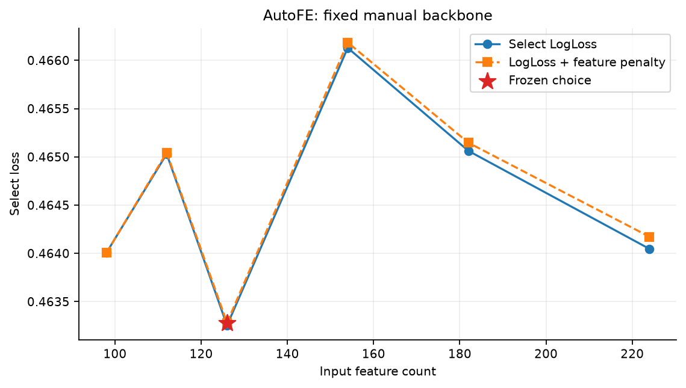
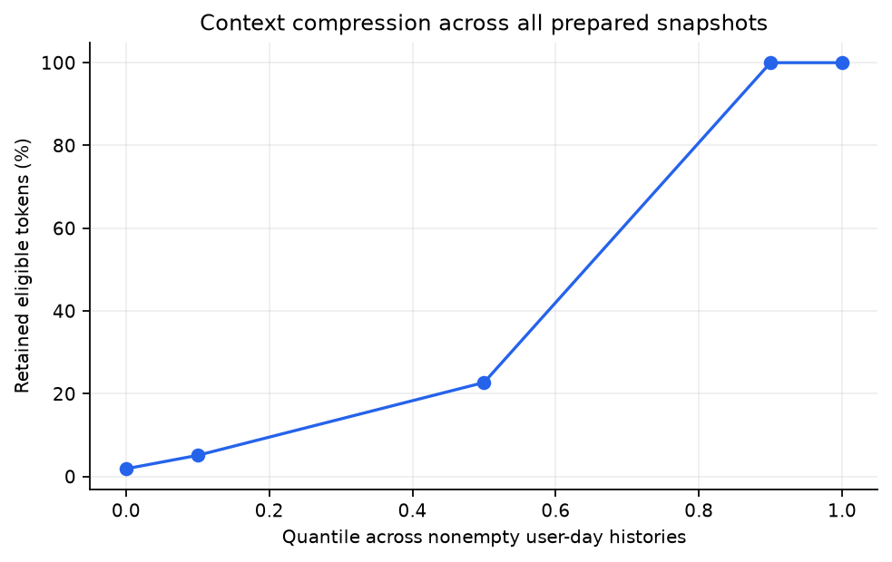
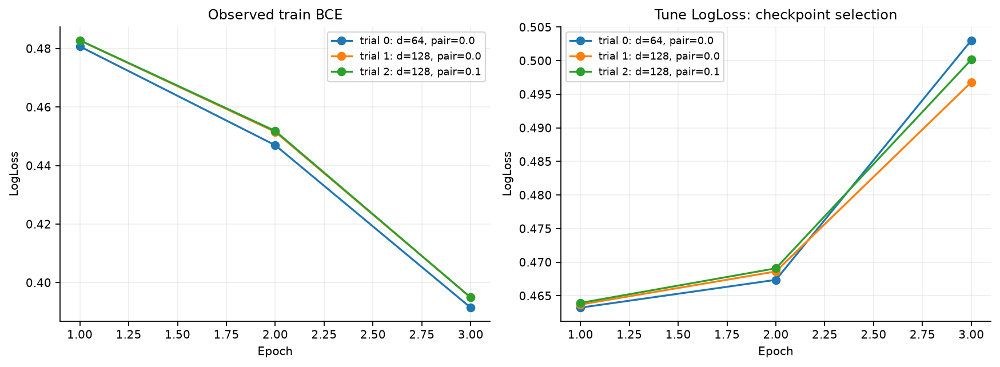
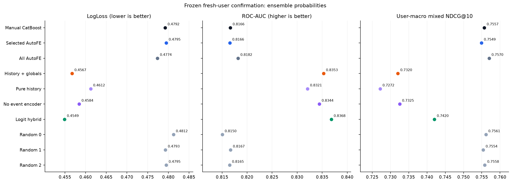
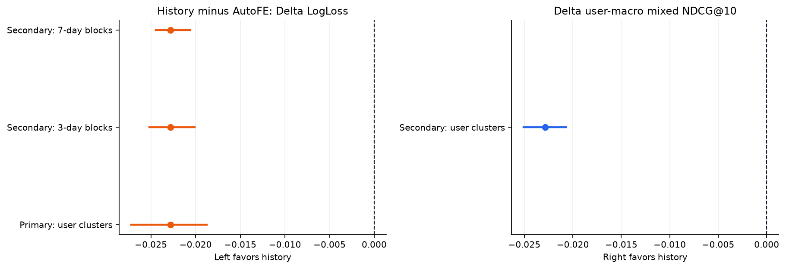
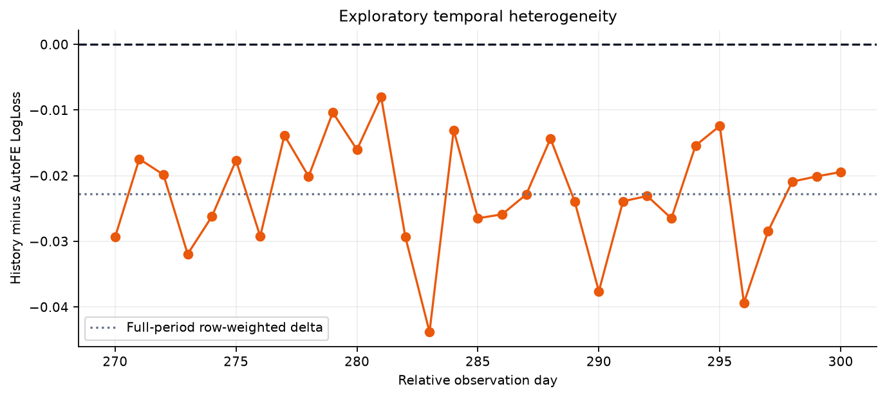
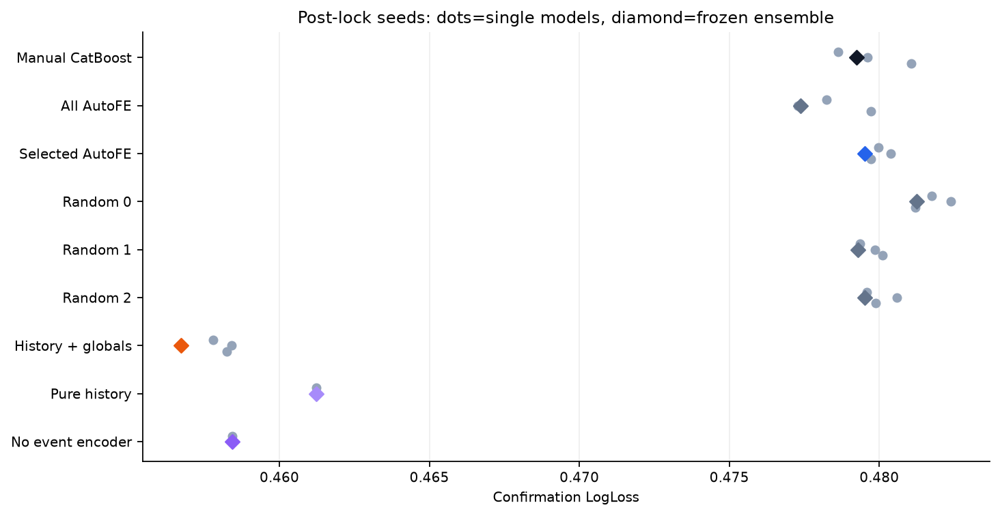
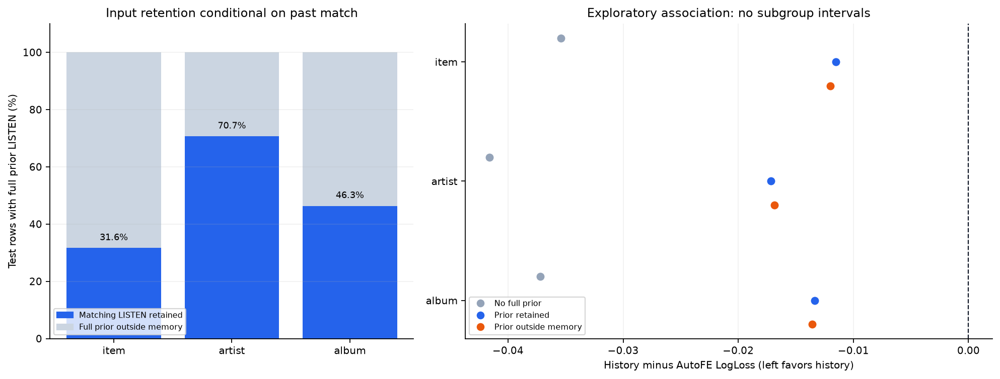
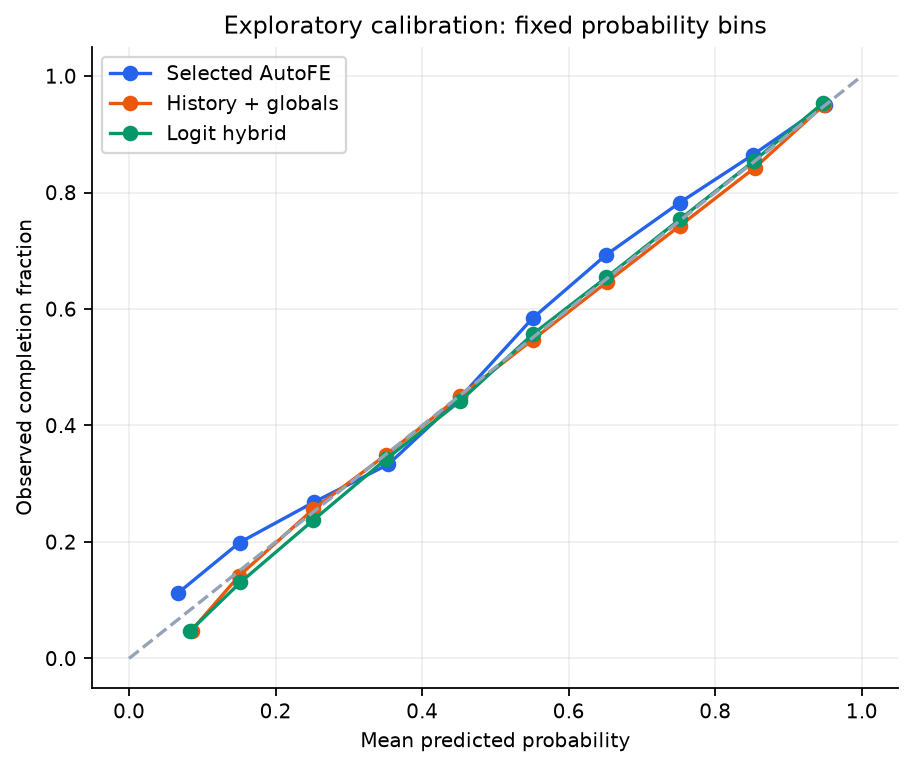
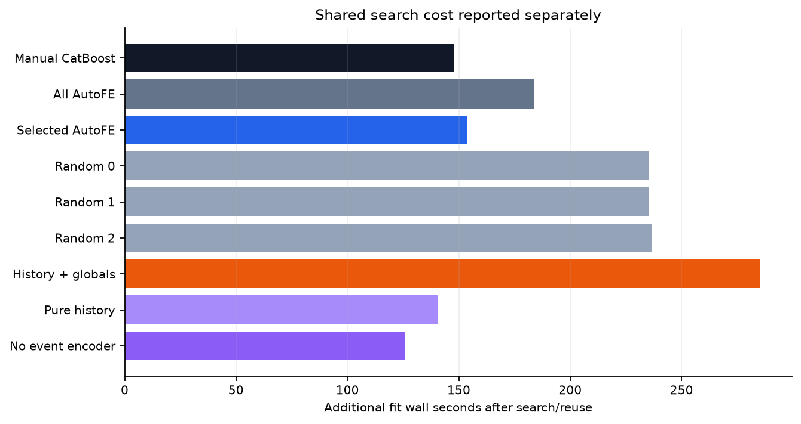

# AutoFE против модели истории: новая подтверждающая выборка

## Результат и граница вывода

Все пользователи v1 исключены. Ранние события новой когорты доступны обучению; конфигурации выбираются только по development targets. Confirmation проверяет будущие исходы другой подкогорты с разрешённым ранним участием в train. Не каждый test UID обязательно имеет supervised train-строки. Новизна относится к пользователям и целевым строкам того же наблюдаемого периода, а не к новому календарному режиму.

HistoryGlobal имеет меньший LogLoss, чем выбранный AutoFE: первичный 95% интервал целиком ниже нуля. Вывод условен на данной популяции, месяце и зафиксированной процедуре. ΔLogLoss (history − AutoFE) = -0.0227943, CI [-0.0271991; -0.0187771]. Вторичная Δ user-macro mixed NDCG@10 = -0.0228767, CI [-0.0250615; -0.0207176].

Победа по LogLoss не означает улучшение порядка треков. Отсутствие значимого вреда не доказывает non-inferiority: для неё нужен заранее обоснованный допустимый margin. Primary-сравнение не заменяется вариантом с лучшим числом в таблице.

## 1. Данные и популяция

Yambda-50M, фиксированная ревизия и SHA256 — в [`manifest.json`](manifest.json). Сохранены **42 906 083 событий 9 000 пользователей** с полными предоставленными исходником историями. Development: 1 000, confirmation: 8 000. Пересечение с v1: 0; development/confirmation: 0. Пользователи выбираются по ID, без отбора по активности или доле положительного класса. Не все confirmation-ID обязательно дают подходящий target; их не заменяют более активными.

Target: первое за относительный день прослушивание user–item среди всех источников; timestamp/source order разрешают равенства. Затем оставляем `is_organic=0`; `label=1[played_ratio_pct>=50]`. Поэтому ранний organic-запуск не заменяется поздним успешным recommended-запуском. Отрицательные примеры — реальные короткие проигрывания, без negative sampling. Это **условное дослушивание уже начатого трека**, не CTR, full-catalog retrieval или причинный эффект смены policy. [Авторы Yambda](https://huggingface.co/datasets/yandex/yambda/discussions/10) поясняют порог и replay >100%.

Item/artist/album metadata считаются известными при запросе и статичными. Для many-to-many выбирается минимальный ID независимо от outcome; так теряются коллаборации и альбомные связи. Время публикации metadata не дано. Пропуски и множественность сохранены в manifest; это ограничение, а не доказанная историческая доступность.

## 2. Время и запечатанный holdout

Timestamp — относительные секунды, уже округлённые до кратных пяти; повторное умножение на пять ошибочно. Календарные weekday/timezone не восстанавливаются. Warm-up до дня 30, границы `[210, 240, 270]`. Лимиты supervised-дней `{'train': 12, 'tune': 4, 'select': 4, 'test': 8}`, seed `1701`: выбранные дни сохраняют все подходящие первые проигрывания, остальные события остаются историей.

| Split | Дни с примерами | Пользователей | User-day | Строк | Положительная доля |
| --- | --- | --- | --- | --- | --- |
| train | 30–209 | 6 394 | 65 363 | 1 787 611 | 0.6532 |
| tune | 210–239 | 695 | 2 421 | 68 447 | 0.6752 |
| select | 240–269 | 745 | 2 631 | 73 274 | 0.6681 |
| test | 270–300 | 6 323 | 38 948 | 1 110 396 | sealed при подготовке |

Train включает ранние targets обеих новых подкогорт. Tune/select используют только development, test — только confirmation. Это не disjoint-user cold-start benchmark: раннее обучение на confirmation разрешено, но не гарантировано для каждого UID. По сохранённым query identity: train содержит 6 394 UID; test — 6 323; из test UID 5 127 имеют supervised train-строки, 1 196 не имеют. Последние всё ещё могут иметь raw-прошлое, например organic-события. Согласование глобального времени и target принципиально для [защиты от утечек](https://arxiv.org/abs/2010.11060) и [sequential evaluation](https://arxiv.org/abs/2507.16289).

```text
listen.available_at = timestamp + ceil(track_length_seconds * played_ratio_pct / 100) + 5
other.available_at  = timestamp + 5
history(query_day d): available_day < d - 1
```

Replay ratio не обрезается при задержке. Train/tune/select-label должен стать доступен до следующей границы; purge до sampling/cohort-фильтра: `{"train": 42, "tune": 45, "select": 64, "test": 0}`. Эти счётчики относятся к исходному пулу, не к уже выбранным дням. Timestamp start/end и wall-clock паузы полностью не документированы: задержка с дневным embargo — консервативное допущение, не доказанная production-механика.

Веса фиксированы, но доступная история обновляется: прежние confirmation-outcome могут стать прошлым последующих дней. Обоим методам задан один cutoff. Текущие ratio, duration, label и source не являются входами. Candidates не attend друг к другу; состав всего будущего slate не нужен для individual score.

Все model paths/хеши и допустимость вероятностей проверяются до label release. **Все** предписанные прогнозы сохранены в `blind_predictions.parquet`, затем `prediction_lock.json`; лишь после этого читается отдельный target-file и проверяются `(uid,item_id,day,group_id)`. Это процедурная защита: raw-log содержит outcomes, а builder обязан видеть разрешённое прошлое. Криптографическая недоступность всех исходных событий не заявляется.

## 3. Сильный baseline и AutoFE

Manual CatBoost: ID и агрегаты user, item, artist, album, user–item, user–artist, user–album; count/rate, recency, historical ratio/organic share, likes/dislikes, user shares и trends. Окна `[7, 30, None]`. Likes/dislikes — исторические количества, не текущий state после отмены действий.

Грамматика добавляет count/rate для box-окон `[2, 3, 10, 14, 60, 90]` и exponential half-life `[3, 10, 45]`. Один kernel образует группу по отношениям. Это ограниченный поиск, связанный с [DFS](https://groups.csail.mit.edu/EVO-DesignOpt/groupWebSite/uploads/Site/DSAA_DSM_2015.pdf), [ExploreKit](https://people.eecs.berkeley.edu/~dawnsong/papers/icdm-2016.pdf) и [OpenFE](https://proceedings.mlr.press/v202/zhang23ay.html), а не новый общий алгоритм AutoFE/SQL/LLM.

Константы удаляются только по train. Manual и AllAuto получают grid `[{'depth': 5, 'learning_rate': 0.06, 'l2_leaf_reg': 5}, {'depth': 7, 'learning_rate': 0.06, 'l2_leaf_reg': 5}, {'depth': 6, 'learning_rate': 0.1, 'l2_leaf_reg': 10}]`, максимум 600 деревьев, early stopping 60; параметры/деревья выбираются на tune. Importance all-auto модели задаёт порядок групп. Префиксы select, включая полный, используют **фиксированные параметры и число деревьев Manual**. Это устраняет confound смены backbone при оценке новых признаков. Независимо настроенный AllAuto показан отдельно.

Criterion: select LogLoss + `1e-06` на дополнительный столбец. Выбрано `['decay_3', 'window_60']`. Это importance-prefix search, не глобальный оптимум: коррелированные окна делят важность, а множество кандидатов создаёт winner's curse.

| Групп | Столбцов | Select LL | Objective | Новый fit, с | Группы |
| --- | --- | --- | --- | --- | --- |
| 0 | 98 | 0.464005 | 0.464005 | 0.00 | manual |
| 1 | 112 | 0.465030 | 0.465044 | 76.98 | decay_3 |
| 2 | 126 | 0.463253 | 0.463281 | 79.15 | decay_3, window_60 |
| 4 | 154 | 0.466129 | 0.466185 | 73.37 | decay_3, window_60, decay_45, decay_10 |
| 6 | 182 | 0.465062 | 0.465146 | 80.68 | decay_3, window_60, decay_45, decay_10, window_90, window_14 |
| 9 | 224 | 0.464046 | 0.464172 | 93.88 | decay_3, window_60, decay_45, decay_10, window_90, window_14, window_2, window_3, window_10 |



Random subsets `[['window_3', 'window_90'], ['decay_3', 'window_2'], ['decay_10', 'decay_3']]` уникальны, равномерны условно на выбранном K, seed `8821`. Запрошено контролей 3, фактически уникальных 3. Если конечное пространство меньше трёх, перечисляется всё. Селектор не исключается из контроля; совпадения `[]` не перерисовываются. Совпадающие спецификации могут переиспользовать fit при одинаковом порядке столбцов. Три контроля не являются точной оценкой распределения всех случайных поисков.

## 4. Обучаемая история и информация

История кодируется один раз на user-day. Candidate-query cross-attends к памяти независимо от остальных candidates. Токены содержат raw item/artist/album ID, тип события, прошлые ratio/organic и log1p возраста. Для категорий используются две prime-mixed hash banks, без vocabulary-fit по будущему. Exact-match bias сравнивает исходные неотрицательные IDs, не hash buckets; missing/PAD не создают ложной связи. Исторический ratio кодируется десятипроцентными bins с cap 200%; это сжатие представления, не availability cap.

Transformer видит уже разрешённое прошлое; двустороннее attention внутри него допустимо. Есть null-token для empty history и явная PAD-mask. Это response-архитектура по мотивам [DIN](https://arxiv.org/abs/1706.06978) и [BST](https://arxiv.org/abs/1905.06874), не точное воспроизведение этих моделей, SASRec next-item или HSTU. Последние 256 событий дополняются до 256 равномерно расположенными старыми chronological indices, без дубликатов и выбора по текущему target.

| Контекст: все подготовленные snapshot | Значение |
| --- | --- |
| context_length | 512 |
| recent_capacity | 256 |
| older_capacity | 256 |
| groups | 109363 |
| empty_groups | 1735 |
| total_available_token_occurrences | 419673750 |
| total_retained_token_occurrences | 49937417 |

Квантили retained/available по непустым user-day: `{"0": 0.01870866371907772, "0.1": 0.051159072741806554, "0.5": 0.2272525521526853, "0.9": 1.0, "1": 1.0}`. Это не только test; token-occurrences повторно учитывают события в разных snapshot и не равны числу уникальных сохранённых исходных действий.



HistoryGlobal получает 37 фиксированных **manual population-marginals**: global prior, item/artist/album count/rate 7/30/all, recency, mean ratio, organic share, likes/dislikes и marginal trends. Нормализатор fit по `train` (1787611 rows), clip `[-12, 12]`; собственные user/pair-агрегаты в primary-head не подаются. Фактически записано marginal-столбцов: 37.

**Общий raw-log и cutoff не означают идентичной сохранённой информации.** AutoFE агрегирует полный eligible prefix и может добавлять global item/artist/album kernels сверх фиксированного блока. Собственная bounded-history не восстанавливает всю population statistics. Сравниваются законченные представления/компрессия при общем базовом marginal-state, а не идеальная информационно тождественная замена каждого агрегата.

Neural grid `[{'d_model': 64, 'n_layers': 2, 'n_heads': 4, 'dropout': 0.1, 'learning_rate': 0.0003, 'pairwise_weight': 0.0}, {'d_model': 128, 'n_layers': 2, 'n_heads': 4, 'dropout': 0.1, 'learning_rate': 0.0003, 'pairwise_weight': 0.0}, {'d_model': 128, 'n_layers': 2, 'n_heads': 4, 'dropout': 0.1, 'learning_rate': 0.0003, 'pairwise_weight': 0.1}]`; AdamW, weight decay `0.0001`, максимум 10 эпох, patience 2. BCE суммируется по valid plays с постоянной expected-rows нормировкой: маленькие user-day не получают лишний вес mean-of-means. Pairwise weight — заранее заданный вариант loss. Выбор epoch/config — по tune LogLoss, не по test NDCG. Gradient clipping 5, precision `bf16`.

| Trial | Параметры | Выбрано эпох | Выполнено эпох | Tune LL | Fit, с | Параметров | Peak allocated GiB |
| --- | --- | --- | --- | --- | --- | --- | --- |
| 0 | {"d_model": 64, "n_layers": 2, "n_heads": 4, "dropout": 0.1, "learning_rate": 0.0003, "pairwise_weight": 0.0} | 1 | 3 | 0.463234 | 431.2 | 14 094 587 | 1.03 |
| 1 | {"d_model": 128, "n_layers": 2, "n_heads": 4, "dropout": 0.1, "learning_rate": 0.0003, "pairwise_weight": 0.0} | 1 | 3 | 0.463695 | 432.7 | 14 517 179 | 1.17 |
| 2 | {"d_model": 128, "n_layers": 2, "n_heads": 4, "dropout": 0.1, "learning_rate": 0.0003, "pairwise_weight": 0.1} | 1 | 3 | 0.463943 | 524.5 | 14 517 179 | 1.17 |



Выбрано `{"d_model": 64, "n_layers": 2, "n_heads": 4, "dropout": 0.1, "learning_rate": 0.0003, "pairwise_weight": 0.0}`, 1 эпох. Выполненные после лучшего checkpoint эпохи не исчезают из затрат. Остальные основные seeds получают фиксированные параметры/число эпох. Pure History и No Event Encoder наследуют их; no-encoder сохраняет age и candidate attention, поэтому это не устранение всей хронологии.

## 5. Зафиксированные модели и качество

| Семейство | Параметры | Деревья/эпохи | Checkpoint | Роль |
| --- | --- | --- | --- | --- |
| Manual CatBoost | {"depth": 7, "learning_rate": 0.06, "l2_leaf_reg": 5} | 257 | 3 | основной/контроль |
| All AutoFE | {"depth": 6, "learning_rate": 0.1, "l2_leaf_reg": 10} | 296 | 3 | основной/контроль |
| Selected AutoFE | {"depth": 7, "learning_rate": 0.06, "l2_leaf_reg": 5} | 257 | 3 | основной/контроль |
| Random 0 | {"depth": 7, "learning_rate": 0.06, "l2_leaf_reg": 5} | 257 | 3 | основной/контроль |
| Random 1 | {"depth": 7, "learning_rate": 0.06, "l2_leaf_reg": 5} | 257 | 3 | основной/контроль |
| Random 2 | {"depth": 7, "learning_rate": 0.06, "l2_leaf_reg": 5} | 257 | 3 | основной/контроль |
| History + globals | {"d_model": 64, "n_layers": 2, "n_heads": 4, "dropout": 0.1, "learning_rate": 0.0003, "pairwise_weight": 0.0} | 1 | 3 | основной/контроль |
| Pure history | {"d_model": 64, "n_layers": 2, "n_heads": 4, "dropout": 0.1, "learning_rate": 0.0003, "pairwise_weight": 0.0} | 1 | 1 | унаследованная абляция |
| No event encoder | {"d_model": 64, "n_layers": 2, "n_heads": 4, "dropout": 0.1, "learning_rate": 0.0003, "pairwise_weight": 0.0} | 1 | 1 | унаследованная абляция |

Основные seed `[17, 29, 43]`, ансамбль — среднее вероятностей. Абляции используют `[17]`; если их меньше, отличие от главного ансамбля не изолирует только удалённый компонент, так как различается ensemble budget. Без одиночного main-seed score это описательный контроль, а не чистый эффект encoder/global features.

Hybrid: `sigmoid(alpha*logit(AutoFE)+(1-alpha)*logit(History))`; alpha=0.25 выбран на select-прогнозах **тех же итоговых ансамблей** по сетке `[0.0, 0.25, 0.5, 0.75, 1.0]`. Test не меняет alpha. 

| Модель | Checkpoint | LogLoss ↓ | ROC-AUC ↑ | Brier ↓ | AP ↑ | User-macro mixed NDCG@10 ↑ | Group-macro mixed Recall@10 ↑ |
| --- | --- | --- | --- | --- | --- | --- | --- |
| Manual CatBoost | 3 | 0.479242 | 0.816632 | 0.157610 | 0.899800 | 0.755688 | 0.555694 |
| Selected AutoFE | 3 | 0.479513 | 0.816557 | 0.157718 | 0.899747 | 0.754909 | 0.555442 |
| All AutoFE | 3 | 0.477383 | 0.818181 | 0.156941 | 0.900866 | 0.757005 | 0.556341 |
| History + globals | 3 | 0.456719 | 0.835277 | 0.149468 | 0.911590 | 0.732032 | 0.540477 |
| Pure history | 1 | 0.461239 | 0.832088 | 0.151024 | 0.909541 | 0.727168 | 0.537331 |
| No event encoder | 1 | 0.458430 | 0.834414 | 0.150023 | 0.910979 | 0.732517 | 0.540698 |
| Logit hybrid | общие веса | 0.454892 | 0.836818 | 0.148624 | 0.912171 | 0.742032 | 0.547514 |
| Random 0 | 3 | 0.481240 | 0.815048 | 0.158442 | 0.899040 | 0.756128 | 0.555683 |
| Random 1 | 3 | 0.479299 | 0.816682 | 0.157628 | 0.899812 | 0.755400 | 0.555400 |
| Random 2 | 3 | 0.479504 | 0.816504 | 0.157713 | 0.899776 | 0.755823 | 0.555755 |



Минимальный наблюдённый test LogLoss у Logit hybrid (0.454892) — описание предписанных контролей, не новое решение. Primary остаётся HistoryGlobal–Selected AutoFE. Покрытие: n_rows: 1 110 396, n_users: 6 323, n_groups: 38 948, n_groups_ge2: 34 807, n_mixed_groups: 26 424, n_mixed_users: 5 712, n_all_positive_groups: 5 953, n_no_positive_groups: 2 430, n_singleton_groups: 4 141. Mixed ranking исключает singleton, no-positive и тривиальные all-positive группы; user-macro сначала усредняет дни внутри пользователя. Это ретроспективное переупорядочивание реально проигранных треков, не полный каталог и не заранее доступный slate. Ties используют expected gain, а не target-based разрешение.

### Первичная гипотеза и вторичная чувствительность

| Resampling | Метрика | History − AutoFE | 95% CI | Повторов |
| --- | --- | --- | --- | --- |
| Primary: users | LogLoss | -0.0227943 | [-0.0271991; -0.0187771] | 5000 |
| Secondary: users | user-macro NDCG | -0.0228767 | [-0.0250615; -0.0207176] | 5000 |
| Secondary: 3-day blocks | LogLoss | -0.0227943 | [-0.0251884; -0.0201233] | 5000 |
| Secondary: 7-day blocks | LogLoss | -0.0227943 | [-0.0244323; -0.0206210] | 5000 |



Пользователи пересэмплируются целиком и парно; LogLoss сохраняет веса строк, ranking равномерно взвешивает подходящих пользователей. Bootstrap условен на уже обученных и выбранных моделях, без fit/selection внутри resampling. Доля улучшившихся resamples — не p-value и не posterior probability. Вторичные сравнения не исправлены за multiplicity.

Circular moving-day blocks 3/7 сохраняют временные промежутки, включая дни без строк. Это отдельная sensitivity к общим временным shocks, **не joint user/time bootstrap** и не доказательство нового будущего режима. Больше пользователей не добавляет независимых будущих месяцев и не устраняет общие item/policy shocks.



### Что дала автоматизация признаков

| Модель − Manual | ΔLogLoss | 95% CI | Δ user-macro NDCG | 95% CI |
| --- | --- | --- | --- | --- |
| Selected AutoFE | 0.0002710 | [-0.0003119; 0.0009065] | -0.0007790 | [-0.0015531; 0.0000031] |
| All AutoFE | -0.0018586 | [-0.0027673; -0.0009008] | 0.0013170 | [0.0003910; 0.0022569] |
| Logit hybrid | -0.0243496 | [-0.0279739; -0.0210301] | -0.0136564 | [-0.0153274; -0.0120326] |

Интервал Selected AutoFE − Manual включает ноль: отбор не подтвердил преимущество над ручным baseline на этом test. Префиксы отбора сохраняют параметры и число деревьев Manual. AllAuto настраивается независимо: его отличие от Manual не изолирует только новые признаки. Hybrid проверяет дополнение двух представлений с весом, выбранным на select. Все интервалы этой таблицы вторичны, без multiplicity correction, и не заменяют primary HistoryGlobal–Selected AutoFE.

Случайные комбинации того же K показаны полностью в таблице качества. Три fixed RNG-контроля не дают основания объявлять общий оптимум грамматики или переизбирать subset по test; они позволяют сопоставить результат селектора с несколькими заранее заданными подмножествами.

### Разброс оптимизационных seed

Одиночные seed оценены prediction-only аудитом после фиксации результата, без переобучения/выбора. SD — выборочное отклонение по оптимизационным seed, не пользовательский CI; ensemble не обязан совпадать со средним отдельных метрик.

| Семейство | Seed | Средний одиночный LL | SD LL | Одиночные значения |
| --- | --- | --- | --- | --- |
| Manual CatBoost | 3 | 0.479767 | 0.001224 | 17: 0.478628; 29: 0.479612; 43: 0.481060 |
| All AutoFE | 3 | 0.478411 | 0.001227 | 17: 0.478233; 29: 0.477282; 43: 0.479717 |
| Selected AutoFE | 3 | 0.480024 | 0.000337 | 17: 0.479964; 29: 0.480386; 43: 0.479721 |
| Random 0 | 3 | 0.481779 | 0.000600 | 17: 0.481758; 29: 0.482389; 43: 0.481191 |
| Random 1 | 3 | 0.479775 | 0.000374 | 17: 0.479366; 29: 0.479859; 43: 0.480100 |
| Random 2 | 3 | 0.480010 | 0.000514 | 17: 0.479580; 29: 0.480579; 43: 0.479870 |
| History + globals | 3 | 0.458153 | 0.000317 | 17: 0.457796; 29: 0.458405; 43: 0.458257 |
| Pure history | 1 | 0.461239 | — | 17: 0.461239 |
| No event encoder | 1 | 0.458430 | — | 17: 0.458430 |



Повторное GPU-inference допускает записанную floating-point tolerance; нулевое отличие не предполагается заранее.

| Семейство | Max probability reload error | Tolerance |
| --- | --- | --- |
| Manual CatBoost | 0.000000000000 | 1e-10 |
| All AutoFE | 0.000000000000 | 1e-10 |
| Selected AutoFE | 0.000000000000 | 1e-10 |
| Random 0 | 0.000000000000 | 1e-10 |
| Random 1 | 0.000000000000 | 1e-10 |
| Random 2 | 0.000000000000 | 1e-10 |
| History + globals | 0.000000000000 | 1e-06 |
| Pure history | 0.000000000000 | 1e-06 |
| No event encoder | 0.000000000000 | 1e-06 |

Дополнительное описательное сравнение **ablation − HistoryGlobal при совпадающей метке seed**, без преимущества трёхмодельного ensemble. Одинаковый номер seed у разных архитектур не означает одинаковые случайные draws. Для одного seed здесь нет оценки неопределённости компонента и нет causal-вывода.

| Абляция | Seed | ΔLogLoss | Δ user-macro NDCG |
| --- | --- | --- | --- |
| Pure history | 17 | 0.0034423 | -0.0046352 |
| No event encoder | 17 | 0.0006338 | 0.0007133 |

## 6. Анализ и exploratory-срезы

LogLoss оценивает и склонность пользователя к дослушиванию, и калибровку; NDCG оценивает порядок треков внутри user-day. Улучшение одного не гарантирует другого. Возможные объяснения различий: bounded memory, редкие ID/hash-коллизии, global state, выбранные kernels, шум выбора и сдвиг состава активности между периодами. Это гипотезы, а не доказанные механизмы. Абляции/coverage помогают локализовать ограничения; меньший ensemble budget не позволяет приписать весь сдвиг одному компоненту.

### Сохранились ли прошлые прослушивания, связанные с кандидатом

Post-lock анализ связывает **полный eligible prefix** с ограниченной памятью без fit, выбора модели и изменения predictions. Для текущих item/artist/album наличие прошлого LISTEN определяется через полный user–entity count, а сохранность — через exact raw-ID match среди context-токенов типа LISTEN. Целевая метка не участвует в построении групп. Три input-only bins: полного прошлого LISTEN нет; он есть и сохранён; он есть, но ни одного соответствующего LISTEN в context не осталось.

Знаменатель retention — **строки test, у которых в полном прошлом есть соответствующий LISTEN**, отдельно для каждого отношения. Это не доля уникальных событий и не доля всех test-строк. Metadata missing указаны отдельно. `history_counts` в исходном JSON описывает контекст по всем типам событий; matching flags в этой таблице используют только LISTEN, поэтому эти количества не взаимозаменяемы.

| Отношение | С полным прошлым LISTEN | Сохранено | Вне context | Retained/full | Нет metadata |
| --- | --- | --- | --- | --- | --- |
| Трек | 593 996 | 187 891 | 406 105 | 0.3163 | 0 |
| Исполнитель | 852 070 | 601 991 | 250 079 | 0.7065 | 75 |
| Альбом | 674 897 | 312 807 | 362 090 | 0.4635 | 0 |



| Отношение | Input-only группа | Строк | UID | AutoFE LL | History LL | ΔLL | AutoFE AUC | History AUC |
| --- | --- | --- | --- | --- | --- | --- | --- | --- |
| Трек | Нет полного прошлого LISTEN | 516 400 | 6 283 | 0.506697 | 0.471304 | -0.0353925 | 0.811466 | 0.839162 |
| Трек | Прошлый LISTEN сохранён | 187 891 | 5 331 | 0.460770 | 0.449247 | -0.0115233 | 0.807768 | 0.819880 |
| Трек | Прошлый LISTEN отсутствует в context | 406 105 | 5 016 | 0.453618 | 0.441629 | -0.0119892 | 0.820832 | 0.832169 |
| Исполнитель | Нет полного прошлого LISTEN | 258 326 | 6 135 | 0.530742 | 0.489116 | -0.0416260 | 0.798820 | 0.831884 |
| Исполнитель | Прошлый LISTEN сохранён | 601 991 | 6 075 | 0.463581 | 0.446401 | -0.0171798 | 0.815424 | 0.830566 |
| Исполнитель | Прошлый LISTEN отсутствует в context | 250 079 | 5 061 | 0.464946 | 0.448089 | -0.0168567 | 0.828130 | 0.842314 |
| Альбом | Нет полного прошлого LISTEN | 435 499 | 6 253 | 0.515688 | 0.478472 | -0.0372166 | 0.806517 | 0.835912 |
| Альбом | Прошлый LISTEN сохранён | 312 807 | 5 784 | 0.452165 | 0.438798 | -0.0133664 | 0.814927 | 0.827724 |
| Альбом | Прошлый LISTEN отсутствует в context | 362 090 | 5 070 | 0.459630 | 0.446037 | -0.0135927 | 0.822286 | 0.834577 |

Это **exploratory ассоциация, не причинный эффект сжатия памяти**: подгруппы различаются активностью, повторяемостью и сложностью примеров, а модель не переобучалась с иной памятью. Разность между строками retained/missing не является оценкой выигрыша от увеличения context. Срезы не использовались для изменения архитектуры/seed/ансамбля; ranking по усечённым candidates не пересчитывается. Исходный CSV сохранён без перезаписи. Источники: [`memory_diagnostic.json`](memory_diagnostic.json), [`memory_diagnostic.csv`](memory_diagnostic.csv).



Bins шириной 0.1 фиксированы; counts сохранены в `calibration.csv`. Это visual diagnostic, без fit/recalibration по test; малые bins могут быть шумными. Следующие срезы **exploratory**, не новая селекция. Только классификация: ranking по урезанным наборам кандидатов не пересчитывается. Интервалы/multiplicity correction по срезам не заявляются.

| Срез | Группа | Строк | Пользователей | P(y=1) | AutoFE LL | History LL | ΔLL |
| --- | --- | --- | --- | --- | --- | --- | --- |
| past_user_listens | 0 | 6 958 | 176 | 0.4406 | 0.656941 | 0.636483 | -0.0204582 |
| past_user_listens | 1–9 | 1 887 | 57 | 0.6545 | 0.614656 | 0.580997 | -0.0336584 |
| past_user_listens | 10–99 | 13 742 | 395 | 0.6222 | 0.621830 | 0.557491 | -0.0643386 |
| past_user_listens | 100–999 | 130 349 | 1 552 | 0.6596 | 0.543059 | 0.491629 | -0.0514295 |
| past_user_listens | 1000+ | 957 460 | 4 904 | 0.6858 | 0.467263 | 0.448968 | -0.0182952 |
| uid_in_supervised_train | есть train-примеры | 914 509 | 5 127 | 0.6915 | 0.467821 | 0.451925 | -0.0158966 |
| uid_in_supervised_train | нет train-примеров | 195 887 | 1 196 | 0.6284 | 0.534096 | 0.479100 | -0.0549964 |
| user_item | нет прошлых прослушиваний | 516 400 | 6 283 | 0.6378 | 0.506697 | 0.471304 | -0.0353925 |
| user_item | есть прошлые прослушивания | 593 996 | 5 539 | 0.7173 | 0.455880 | 0.444039 | -0.0118418 |
| user_artist | нет прошлых прослушиваний | 258 326 | 6 135 | 0.6123 | 0.530742 | 0.489116 | -0.0416260 |
| user_artist | есть прошлые прослушивания | 852 070 | 6 106 | 0.7010 | 0.463981 | 0.446896 | -0.0170850 |
| item_in_sample | нет прошлых прослушиваний | 17 790 | 3 287 | 0.5909 | 0.502535 | 0.475623 | -0.0269116 |
| item_in_sample | есть прошлые прослушивания | 1 092 606 | 6 319 | 0.6818 | 0.479138 | 0.456411 | -0.0227272 |

`item_in_sample` означает прошлые listens внутри выбранной когорты, не истинный возраст трека. Нет прошлой пары — не то же, что отсутствующий ID при train. User-history count считает listens; raw context дополнительно включает другие типы действий.

## 7. Реальные вычисления и масштаб

Окружение **сохранённого запуска**: `{"platform": "Linux-6.8.0-147-generic-x86_64-with-glibc2.39", "torch": "2.8.0+cu128", "cuda_available": true, "cuda_build": "12.8", "gpu": "NVIDIA A100-SXM4-80GB", "gpu_bytes": 85094825984, "bf16_supported": true, "is_pilot": false, "n_users": 9000}`. CatBoost CPU threads: 16; batch capacity history: 16 user-day. В исследовании основной запуск использовал PyTorch 2.8/cu128, локальная разработка — CPU PyTorch 2.14. Точные версии обеих сред зафиксированы отдельно; CUDA-версия записана в runtime metadata и GPU lock.

Вся подготовка: 1055.9 с; вложенные data sampling/I/O 71.6 с, feature engine 949.1 с. Матрица 3 039 728 × 224, DataFrame estimate 2717.4 MiB. Эти таймеры нельзя складывать как независимые стадии.

| Учтённый компонент | Секунды |
| --- | --- |
| tabular_search_fit_seconds | 951.4 |
| tabular_additional_final_fit_seconds | 1192.8 |
| tabular_phase_wall_seconds | 2217.9 |
| neural_search_fit_seconds | 1388.3 |
| neural_additional_final_fit_seconds | 551.5 |

| Семейство | Checkpoint | Доп. fit после search, с | Параметров сети | Peak allocated GiB | Деревья/эпохи |
| --- | --- | --- | --- | --- | --- |
| Manual CatBoost | 3 | 148.0 | — | — | 257 |
| All AutoFE | 3 | 183.7 | — | — | 296 |
| Selected AutoFE | 3 | 153.5 | — | — | 257 |
| Random 0 | 3 | 235.2 | — | — | 257 |
| Random 1 | 3 | 235.5 | — | — | 257 |
| Random 2 | 3 | 236.8 | — | — | 257 |
| History + globals | 3 | 285.2 | 14 094 587 | 1.03 | 1 |
| Pure history | 1 | 140.4 | 14 089 777 | 1.02 | 1 |
| No event encoder | 1 | 125.9 | 13 961 851 | 0.98 | 1 |



Reused search-winner не оплачивается второй раз: CatBoost reuse имеет fit=0, neural copy не прибавляет исходный search-fit повторно. Neural search учитывает все trials и rejected поздние эпохи; остальные main seeds и абляции добавляются отдельно. Это training-таймеры, **не полное end-to-end время и не денежная стоимость**. Neural fit включает epochs/tune/checkpoint после создания модели/optimizer; не все install, transfer, profile, final inference и debugging входят в сумму. Одинаковое число trials не означает одинаковых FLOPs или CPU/GPU-бюджета. Tabular process peak RSS 10633.1 MiB включает caller allocations, не изолированную память одного fit.

Train-only capacity probe: 100 измеренных шагов; mean step 0.0436 с, valid queries/s 9691.7, peak allocated 0.69 GiB, peak reserved 0.89 GiB. Конфигурация `{"d_model": 128, "n_layers": 2, "n_heads": 4, "dropout": 0.1, "learning_rate": 0.0003, "pairwise_weight": 0.1}`; probe не выбирал модель и не открывал confirmation targets. Полный [`gpu_profile.json`](gpu_profile.json) сохраняет padding и окружение. Его `projection` — экстраполяция короткого probe, **не выполненная эпоха/полный запуск и не гарантия времени или цены**; она исключает validation, AutoFE/CPU, подготовку, I/O и повторные прогоны.

History-cache переиспользуется на user-day, сокращая повторное Transformer-кодирование. Attention всё равно растёт квадратично по длине контекста; supervised sampling меняет число групп и candidates. Distributed throughput, online tail latency и промышленный миллиардный масштаб здесь не измерялись.

## 8. Вывод и воспроизведение

HistoryGlobal имеет меньший LogLoss, чем выбранный AutoFE: первичный 95% интервал целиком ниже нуля. Вывод условен на данной популяции, месяце и зафиксированной процедуре. ΔLogLoss (history − AutoFE) = -0.0227943, CI [-0.0271991; -0.0187771]. Вторичная Δ user-macro mixed NDCG@10 = -0.0228767, CI [-0.0250615; -0.0207176].

Результат относится к выбранной активности Yambda, logged-play target и наблюдаемому периоду. Он не доказывает retrieval/online uplift или универсальную победу Transformer/AutoFE. Следующие варианты потребуют нового подтверждающего набора: этот test не превращается в validation для архитектуры, окна, seed или blend.

```bash
PYTHONPATH=src python -m recsys_history_v2.run --config configs/v2_reproduce.yaml --phase register
PYTHONPATH=src python -m recsys_history_v2.run --config configs/v2_reproduce.yaml --phase prepare
PYTHONPATH=src python scripts/profile_v2_gpu.py --config configs/v2_reproduce.yaml
PYTHONPATH=src python -m recsys_history_v2.run --config configs/v2_reproduce.yaml --phase search
PYTHONPATH=src python -m recsys_history_v2.run --config configs/v2_reproduce.yaml --phase evaluate
PYTHONPATH=src python -m recsys_history_v2.run --config configs/v2_reproduce.yaml --phase report
```

Это команды основного зарегистрированного исследования; pilot использует отдельные YAML/каталоги и более ранние дни. Повторный evaluate при prediction lock запрещён. GPU/веса не требуются для чтения сохранённых результатов: этот генератор не обучает и не предсказывает моделью.

Артефакты: [selection](selection_lock.json), [prediction lock](prediction_lock.json), [результаты](test_results.json), [прогнозы](test_predictions.parquet), [tabular search](tabular_search.json), [neural trials](neural_trials.json), [подготовка/context](preparation_lock.json), [данные](manifest.json), [калибровка](calibration.csv), [срезы](exploratory_subgroups.csv), [затраты](training_costs.csv). Optional `seed_metrics.json` содержит только post-lock диагностику. Проверенная selection SHA256 `2f239d771533708ff2b9e18baea1108c235b17e4c17aa86eaee9aec522c436c6`; prediction SHA256 `1bd3fe06fb29def69ff06a0745ffd57ba2fff58f0b79ab2babe36bf6833bd070`. При наличии blind parquet дополнительно проверены его hash, отсутствие label и неизменность probabilities после release.

Первичные источники и дизайн: [sequence research](../SEQUENCE_RESEARCH.md), [протокол](../PROTOCOL_REVIEW.md), [v1 как отдельное исследование](../../main/REPORT.md). V2 отделён от замороженного v1, а его просмотренный test не использовался как новый validation.
