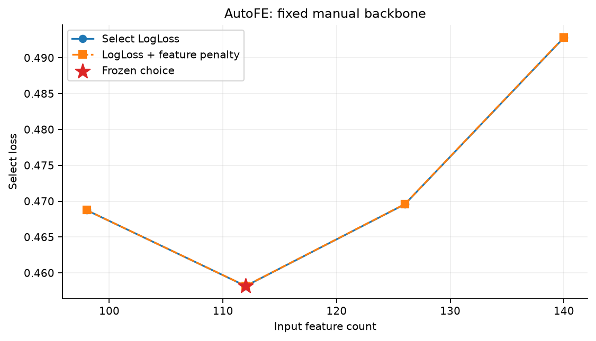
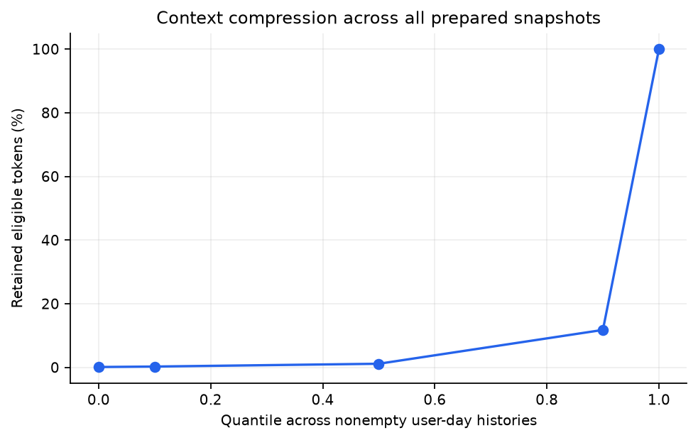
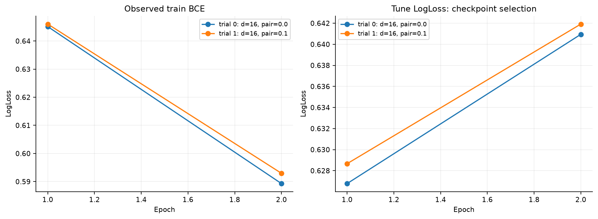
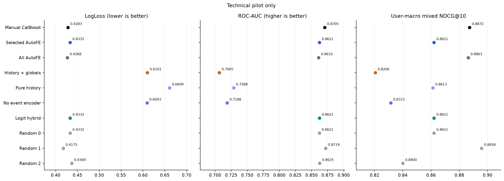
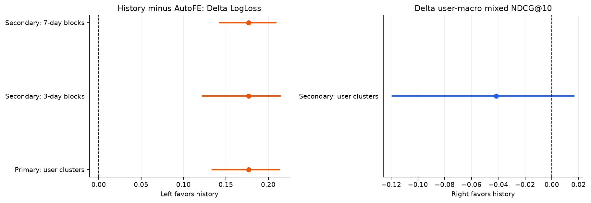
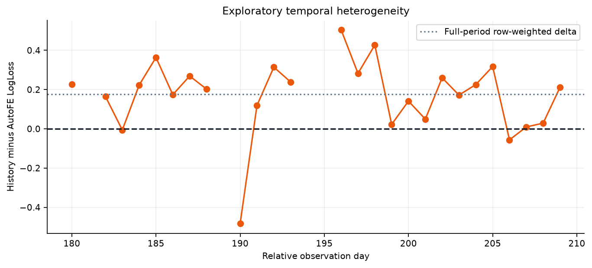
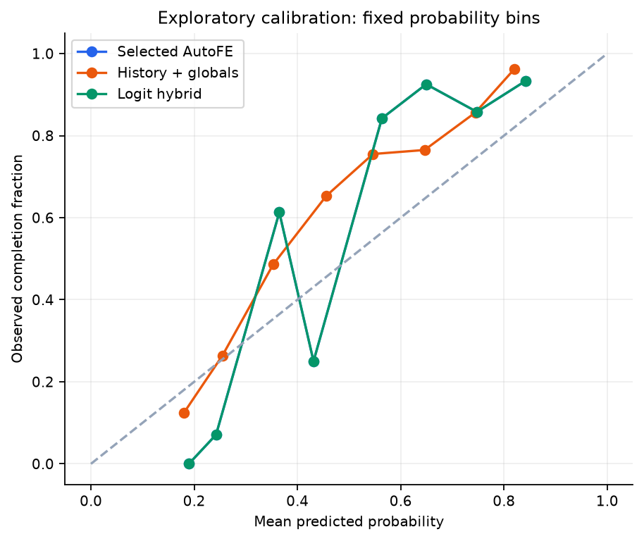
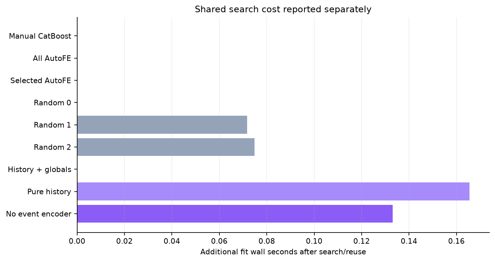

# ТЕХНИЧЕСКИЙ PILOT — не подтверждающий эксперимент

## Результат и граница вывода

Эта малая выборка проверяет только исполнимость кода. Пользователи взяты из development основной когорты; периоды заканчиваются до основного месяца. Числа pilot нельзя выдавать за результат полного исследования.

HistoryGlobal не превзошёл выбранный AutoFE: его LogLoss выше, и первичный 95% интервал целиком выше нуля. Больше данных и обучаемая история сами по себе не гарантировали замену агрегатов. ΔLogLoss (history − AutoFE) = 0.1769574, CI [0.1341315; 0.2130810]. Вторичная Δ user-macro mixed NDCG@10 = -0.0415153, CI [-0.1189888; 0.0165405].

Победа по LogLoss не означает улучшение порядка треков. Отсутствие значимого вреда не доказывает non-inferiority: для неё нужен заранее обоснованный допустимый margin. Primary-сравнение не заменяется вариантом с лучшим числом в таблице.

## 1. Данные и популяция

Yambda-50M, фиксированная ревизия и SHA256 — в [`manifest.json`](manifest.json). Сохранены **219 287 событий 50 пользователей** с полными предоставленными исходником историями. Development: 10, confirmation: 40. Пересечение с v1: 0; development/confirmation: 0. Пользователи выбираются по ID, без отбора по активности или доле положительного класса. Не все confirmation-ID обязательно дают подходящий target; их не заменяют более активными.

Target: первое за относительный день прослушивание user–item среди всех источников; timestamp/source order разрешают равенства. Затем оставляем `is_organic=0`; `label=1[played_ratio_pct>=50]`. Поэтому ранний organic-запуск не заменяется поздним успешным recommended-запуском. Отрицательные примеры — реальные короткие проигрывания, без negative sampling. Это **условное дослушивание уже начатого трека**, не CTR, full-catalog retrieval или причинный эффект смены policy. [Авторы Yambda](https://huggingface.co/datasets/yandex/yambda/discussions/10) поясняют порог и replay >100%.

Item/artist/album metadata считаются известными при запросе и статичными. Для many-to-many выбирается минимальный ID независимо от outcome; так теряются коллаборации и альбомные связи. Время публикации metadata не дано. Пропуски и множественность сохранены в manifest; это ограничение, а не доказанная историческая доступность.

## 2. Время и запечатанный holdout

Timestamp — относительные секунды, уже округлённые до кратных пяти; повторное умножение на пять ошибочно. Календарные weekday/timezone не восстанавливаются. Warm-up до дня 30, границы `[120, 150, 180]`. Лимиты supervised-дней `{'train': 3, 'tune': 2, 'select': 2, 'test': 2}`, seed `1701`: выбранные дни сохраняют все подходящие первые проигрывания, остальные события остаются историей.

| Split | Дни с примерами | Пользователей | User-day | Строк | Положительная доля |
| --- | --- | --- | --- | --- | --- |
| train | 31–119 | 28 | 83 | 2 098 | 0.6811 |
| tune | 121–145 | 7 | 14 | 329 | 0.6292 |
| select | 150–179 | 7 | 12 | 172 | 0.4651 |
| test | 180–209 | 24 | 44 | 1 164 | sealed при подготовке |

Train включает ранние targets обеих новых подкогорт. Tune/select используют только development, test — только confirmation. Это не disjoint-user cold-start benchmark: раннее обучение на confirmation разрешено, но не гарантировано для каждого UID. По сохранённым query identity: train содержит 28 UID; test — 24; из test UID 20 имеют supervised train-строки, 4 не имеют. Последние всё ещё могут иметь raw-прошлое, например organic-события. Согласование глобального времени и target принципиально для [защиты от утечек](https://arxiv.org/abs/2010.11060) и [sequential evaluation](https://arxiv.org/abs/2507.16289).

```text
listen.available_at = timestamp + ceil(track_length_seconds * played_ratio_pct / 100) + 5
other.available_at  = timestamp + 5
history(query_day d): available_day < d - 1
```

Replay ratio не обрезается при задержке. Train/tune/select-label должен стать доступен до следующей границы; purge до sampling/cohort-фильтра: `{"train": 0, "tune": 0, "select": 1, "test": 0}`. Эти счётчики относятся к исходному пулу, не к уже выбранным дням. Timestamp start/end и wall-clock паузы полностью не документированы: задержка с дневным embargo — консервативное допущение, не доказанная production-механика.

Веса фиксированы, но доступная история обновляется: прежние confirmation-outcome могут стать прошлым последующих дней. Обоим методам задан один cutoff. Текущие ratio, duration, label и source не являются входами. Candidates не attend друг к другу; состав всего будущего slate не нужен для individual score.

Все model paths/хеши и допустимость вероятностей проверяются до label release. **Все** предписанные прогнозы сохранены в `blind_predictions.parquet`, затем `prediction_lock.json`; лишь после этого читается отдельный target-file и проверяются `(uid,item_id,day,group_id)`. Это процедурная защита: raw-log содержит outcomes, а builder обязан видеть разрешённое прошлое. Криптографическая недоступность всех исходных событий не заявляется.

## 3. Сильный baseline и AutoFE

Manual CatBoost: ID и агрегаты user, item, artist, album, user–item, user–artist, user–album; count/rate, recency, historical ratio/organic share, likes/dislikes, user shares и trends. Окна `[7, 30, None]`. Likes/dislikes — исторические количества, не текущий state после отмены действий.

Грамматика добавляет count/rate для box-окон `[3, 14]` и exponential half-life `[10]`. Один kernel образует группу по отношениям. Это ограниченный поиск, связанный с [DFS](https://dai.lids.mit.edu/wp-content/uploads/2017/10/DSAA_DSM_2015.pdf), [ExploreKit](https://people.eecs.berkeley.edu/~dawnsong/papers/icdm-2016.pdf) и [OpenFE](https://proceedings.mlr.press/v202/zhang23ay.html), а не новый общий алгоритм AutoFE/SQL/LLM.

Константы удаляются только по train. Manual и AllAuto получают grid `[{'depth': 3, 'learning_rate': 0.1, 'l2_leaf_reg': 5}, {'depth': 4, 'learning_rate': 0.1, 'l2_leaf_reg': 5}]`, максимум 30 деревьев, early stopping 10; параметры/деревья выбираются на tune. Importance all-auto модели задаёт порядок групп. Префиксы select, включая полный, используют **фиксированные параметры и число деревьев Manual**. Это устраняет confound смены backbone при оценке новых признаков. Независимо настроенный AllAuto показан отдельно.

Criterion: select LogLoss + `1e-06` на дополнительный столбец. Выбрано `['decay_10']`. Это importance-prefix search, не глобальный оптимум: коррелированные окна делят важность, а множество кандидатов создаёт winner's curse.

| Групп | Столбцов | Select LL | Objective | Новый fit, с | Группы |
| --- | --- | --- | --- | --- | --- |
| 0 | 98 | 0.468757 | 0.468757 | 0.00 | manual |
| 1 | 112 | 0.458166 | 0.458180 | 0.07 | decay_10 |
| 2 | 126 | 0.469566 | 0.469594 | 0.09 | decay_10, window_14 |
| 3 | 140 | 0.492814 | 0.492856 | 0.09 | decay_10, window_14, window_3 |



Random subsets `[['decay_10'], ['window_14'], ['window_3']]` уникальны, равномерны условно на выбранном K, seed `8821`. Запрошено контролей 3, фактически уникальных 3. Если конечное пространство меньше трёх, перечисляется всё. Селектор не исключается из контроля; совпадения `[0]` не перерисовываются. Совпадающие спецификации могут переиспользовать fit при одинаковом порядке столбцов. Три контроля не являются точной оценкой распределения всех случайных поисков.

## 4. Обучаемая история и информация

История кодируется один раз на user-day. Candidate-query cross-attends к памяти независимо от остальных candidates. Токены содержат raw item/artist/album ID, тип события, прошлые ratio/organic и log1p возраста. Для категорий используются две prime-mixed hash banks, без vocabulary-fit по будущему. Exact-match bias сравнивает исходные неотрицательные IDs, не hash buckets; missing/PAD не создают ложной связи. Исторический ratio кодируется десятипроцентными bins с cap 200%; это сжатие представления, не availability cap.

Transformer видит уже разрешённое прошлое; двустороннее attention внутри него допустимо. Есть null-token для empty history и явная PAD-mask. Это response-архитектура по мотивам [DIN](https://arxiv.org/abs/1706.06978) и [BST](https://arxiv.org/abs/1905.06874), не точное воспроизведение этих моделей, SASRec next-item или HSTU. Последние 8 событий дополняются до 8 равномерно расположенными старыми chronological indices, без дубликатов и выбора по текущему target.

| Контекст: все подготовленные snapshot | Значение |
| --- | --- |
| context_length | 16 |
| recent_capacity | 8 |
| older_capacity | 8 |
| groups | 153 |
| empty_groups | 7 |
| total_available_token_occurrences | 343842 |
| total_retained_token_occurrences | 2294 |

Квантили retained/available по непустым user-day: `{"0": 0.0011342691053452432, "0.1": 0.0025816734809777525, "0.5": 0.011380008093889114, "0.9": 0.11765341984320087, "1": 1.0}`. Это не только test; token-occurrences повторно учитывают события в разных snapshot и не равны числу уникальных сохранённых исходных действий.



HistoryGlobal получает 37 фиксированных **manual population-marginals**: global prior, item/artist/album count/rate 7/30/all, recency, mean ratio, organic share, likes/dislikes и marginal trends. Нормализатор fit по `train` (2098 rows), clip `[-12, 12]`; собственные user/pair-агрегаты в primary-head не подаются. Фактически записано marginal-столбцов: 37.

**Общий raw-log и cutoff не означают идентичной сохранённой информации.** AutoFE агрегирует полный eligible prefix и может добавлять global item/artist/album kernels сверх фиксированного блока. Собственная bounded-history не восстанавливает всю population statistics. Сравниваются законченные представления/компрессия при общем базовом marginal-state, а не идеальная информационно тождественная замена каждого агрегата.

Neural grid `[{'d_model': 16, 'n_layers': 1, 'n_heads': 2, 'dropout': 0.0, 'learning_rate': 0.003, 'pairwise_weight': 0.0}, {'d_model': 16, 'n_layers': 1, 'n_heads': 2, 'dropout': 0.0, 'learning_rate': 0.003, 'pairwise_weight': 0.1}]`; AdamW, weight decay `0.0001`, максимум 2 эпох, patience 1. BCE суммируется по valid plays с постоянной expected-rows нормировкой: маленькие user-day не получают лишний вес mean-of-means. Pairwise weight — заранее заданный вариант loss. Выбор epoch/config — по tune LogLoss, не по test NDCG. Gradient clipping 5, precision `fp32`.

| Trial | Параметры | Выбрано эпох | Выполнено эпох | Tune LL | Fit, с | Параметров | Peak allocated GiB |
| --- | --- | --- | --- | --- | --- | --- | --- |
| 0 | {"d_model": 16, "n_layers": 1, "n_heads": 2, "dropout": 0.0, "learning_rate": 0.003, "pairwise_weight": 0.0} | 1 | 2 | 0.626776 | 0.6 | 51 125 | — |
| 1 | {"d_model": 16, "n_layers": 1, "n_heads": 2, "dropout": 0.0, "learning_rate": 0.003, "pairwise_weight": 0.1} | 1 | 2 | 0.628665 | 0.4 | 51 125 | — |



Выбрано `{"d_model": 16, "n_layers": 1, "n_heads": 2, "dropout": 0.0, "learning_rate": 0.003, "pairwise_weight": 0.0}`, 1 эпох. Выполненные после лучшего checkpoint эпохи не исчезают из затрат. Остальные основные seeds получают фиксированные параметры/число эпох. Pure History и No Event Encoder наследуют их; no-encoder сохраняет age и candidate attention, поэтому это не устранение всей хронологии.

## 5. Зафиксированные модели и качество

| Семейство | Параметры | Деревья/эпохи | Checkpoint | Роль |
| --- | --- | --- | --- | --- |
| Manual CatBoost | {"depth": 4, "learning_rate": 0.1, "l2_leaf_reg": 5} | 17 | 1 | основной/контроль |
| All AutoFE | {"depth": 3, "learning_rate": 0.1, "l2_leaf_reg": 5} | 22 | 1 | основной/контроль |
| Selected AutoFE | {"depth": 4, "learning_rate": 0.1, "l2_leaf_reg": 5} | 17 | 1 | основной/контроль |
| Random 0 | {"depth": 4, "learning_rate": 0.1, "l2_leaf_reg": 5} | 17 | 1 | основной/контроль |
| Random 1 | {"depth": 4, "learning_rate": 0.1, "l2_leaf_reg": 5} | 17 | 1 | основной/контроль |
| Random 2 | {"depth": 4, "learning_rate": 0.1, "l2_leaf_reg": 5} | 17 | 1 | основной/контроль |
| History + globals | {"d_model": 16, "n_layers": 1, "n_heads": 2, "dropout": 0.0, "learning_rate": 0.003, "pairwise_weight": 0.0} | 1 | 1 | основной/контроль |
| Pure history | {"d_model": 16, "n_layers": 1, "n_heads": 2, "dropout": 0.0, "learning_rate": 0.003, "pairwise_weight": 0.0} | 1 | 1 | унаследованная абляция |
| No event encoder | {"d_model": 16, "n_layers": 1, "n_heads": 2, "dropout": 0.0, "learning_rate": 0.003, "pairwise_weight": 0.0} | 1 | 1 | унаследованная абляция |

Основные seed `[17]`, ансамбль — среднее вероятностей. Абляции используют `[17]`; если их меньше, отличие от главного ансамбля не изолирует только удалённый компонент, так как различается ensemble budget. Без одиночного main-seed score это описательный контроль, а не чистый эффект encoder/global features.

Hybrid: `sigmoid(alpha*logit(AutoFE)+(1-alpha)*logit(History))`; alpha=1.0 выбран на select-прогнозах **тех же итоговых ансамблей** по сетке `[0.0, 0.25, 0.5, 0.75, 1.0]`. Test не меняет alpha. При alpha=1 hybrid не добавляет history-прогноз.

| Модель | Checkpoint | LogLoss ↓ | ROC-AUC ↑ | Brier ↓ | AP ↑ | User-macro mixed NDCG@10 ↑ | Group-macro mixed Recall@10 ↑ |
| --- | --- | --- | --- | --- | --- | --- | --- |
| Manual CatBoost | 1 | 0.428310 | 0.870455 | 0.129062 | 0.908907 | 0.887225 | 0.568530 |
| Selected AutoFE | 1 | 0.433191 | 0.862144 | 0.130911 | 0.908855 | 0.862085 | 0.558161 |
| All AutoFE | 1 | 0.426799 | 0.861005 | 0.128816 | 0.905431 | 0.886285 | 0.572190 |
| History + globals | 1 | 0.610149 | 0.706525 | 0.210868 | 0.819032 | 0.820570 | 0.544466 |
| Pure history | 1 | 0.660933 | 0.728843 | 0.233952 | 0.843615 | 0.861276 | 0.551359 |
| No event encoder | 1 | 0.609284 | 0.718774 | 0.210359 | 0.827746 | 0.831515 | 0.556766 |
| Logit hybrid | общие веса | 0.433191 | 0.862144 | 0.130911 | 0.908855 | 0.862085 | 0.558161 |
| Random 0 | 1 | 0.433191 | 0.862144 | 0.130911 | 0.908855 | 0.862085 | 0.558161 |
| Random 1 | 1 | 0.417530 | 0.871863 | 0.124852 | 0.915982 | 0.895811 | 0.563788 |
| Random 2 | 1 | 0.436919 | 0.862548 | 0.133201 | 0.908488 | 0.840021 | 0.554973 |



Минимальный наблюдённый test LogLoss у Random 1 (0.417530) — описание предписанных контролей, не новое решение. Primary остаётся HistoryGlobal–Selected AutoFE. Покрытие: n_rows: 1 164, n_users: 24, n_groups: 44, n_groups_ge2: 40, n_mixed_groups: 26, n_mixed_users: 17, n_all_positive_groups: 9, n_no_positive_groups: 5, n_singleton_groups: 4. Mixed ranking исключает singleton, no-positive и тривиальные all-positive группы; user-macro сначала усредняет дни внутри пользователя. Это ретроспективное переупорядочивание реально проигранных треков, не полный каталог и не заранее доступный slate. Ties используют expected gain, а не target-based разрешение.

### Первичная гипотеза и вторичная чувствительность

| Resampling | Метрика | History − AutoFE | 95% CI | Повторов |
| --- | --- | --- | --- | --- |
| Primary: users | LogLoss | 0.1769574 | [0.1341315; 0.2130810] | 100 |
| Secondary: users | user-macro NDCG | -0.0415153 | [-0.1189888; 0.0165405] | 100 |
| Secondary: 3-day blocks | LogLoss | 0.1769574 | [0.1225640; 0.2140474] | 100 |
| Secondary: 7-day blocks | LogLoss | 0.1769574 | [0.1426390; 0.2090584] | 100 |



Пользователи пересэмплируются целиком и парно; LogLoss сохраняет веса строк, ranking равномерно взвешивает подходящих пользователей. Bootstrap условен на уже обученных и выбранных моделях, без fit/selection внутри resampling. Доля улучшившихся resamples — не p-value и не posterior probability. Вторичные сравнения не исправлены за multiplicity.

Circular moving-day blocks 3/7 сохраняют временные промежутки, включая дни без строк. Это отдельная sensitivity к общим временным shocks, **не joint user/time bootstrap** и не доказательство нового будущего режима. Больше пользователей не добавляет независимых будущих месяцев и не устраняет общие item/policy shocks.



### Разброс оптимизационных seed

Per-seed test diagnostics не сохранены или не завершены. Разброс оптимизации на confirmation не придумывается: зафиксированные seed используются в ансамбле, а пользовательский bootstrap измеряет другую неопределённость.

## 6. Анализ и exploratory-срезы

LogLoss оценивает и склонность пользователя к дослушиванию, и калибровку; NDCG оценивает порядок треков внутри user-day. Улучшение одного не гарантирует другого. Возможные объяснения различий: bounded memory, редкие ID/hash-коллизии, global state, выбранные kernels, шум выбора и сдвиг состава активности между периодами. Это гипотезы, а не доказанные механизмы. Абляции/coverage помогают локализовать ограничения; меньший ensemble budget не позволяет приписать весь сдвиг одному компоненту.




Bins шириной 0.1 фиксированы; counts сохранены в `calibration.csv`. Это visual diagnostic, без fit/recalibration по test; малые bins могут быть шумными. Следующие срезы **exploratory**, не новая селекция. Только классификация: ranking по урезанным наборам кандидатов не пересчитывается. Интервалы/multiplicity correction по срезам не заявляются.

| Срез | Группа | Строк | Пользователей | P(y=1) | AutoFE LL | History LL | ΔLL |
| --- | --- | --- | --- | --- | --- | --- | --- |
| past_user_listens | 0 | 116 | 2 | 0.9483 | 0.502456 | 0.736711 | 0.2342557 |
| past_user_listens | 10–99 | 12 | 1 | 1.0000 | 0.707550 | 0.467384 | -0.2401658 |
| past_user_listens | 100–999 | 133 | 4 | 0.5038 | 0.433439 | 0.622328 | 0.1888889 |
| past_user_listens | 1000+ | 903 | 18 | 0.6722 | 0.420611 | 0.593994 | 0.1733826 |
| uid_in_supervised_train | есть train-примеры | 947 | 20 | 0.6853 | 0.414255 | 0.590345 | 0.1760901 |
| uid_in_supervised_train | нет train-примеров | 217 | 4 | 0.6774 | 0.515829 | 0.696572 | 0.1807425 |
| user_item | нет прошлых прослушиваний | 590 | 23 | 0.6508 | 0.475397 | 0.691321 | 0.2159241 |
| user_item | есть прошлые прослушивания | 574 | 20 | 0.7178 | 0.389809 | 0.526713 | 0.1369046 |
| user_artist | нет прошлых прослушиваний | 341 | 20 | 0.6716 | 0.506842 | 0.702842 | 0.1960000 |
| user_artist | есть прошлые прослушивания | 823 | 22 | 0.6889 | 0.402675 | 0.571742 | 0.1690674 |
| item_in_sample | нет прошлых прослушиваний | 255 | 20 | 0.7059 | 0.472460 | 0.653463 | 0.1810034 |
| item_in_sample | есть прошлые прослушивания | 909 | 24 | 0.6777 | 0.422175 | 0.597998 | 0.1758224 |

`item_in_sample` означает прошлые listens внутри выбранной когорты, не истинный возраст трека. Нет прошлой пары — не то же, что отсутствующий ID при train. User-history count считает listens; raw context дополнительно включает другие типы действий.

## 7. Реальные вычисления и масштаб

Окружение **сохранённого запуска**, не генератора отчёта: `{"platform": "macOS-15.0.1-arm64-arm-64bit", "torch": "2.14.1", "cuda_available": false, "cuda_build": null, "gpu": null, "gpu_bytes": null, "bf16_supported": false, "is_pilot": true, "n_users": 50}`. CatBoost CPU threads: 2; batch capacity history: 4 user-day. A100 не переименовывается в H100. GPU PyTorch 2.8/cu128 и локальный CPU PyTorch 2.14 — разные среды; основная версия определяется metadata и проверяется до запуска, а пилот не заменяет CUDA-проверку.

Вся подготовка: 12.0 с; вложенные data sampling/I/O 10.7 с, feature engine 0.9 с. Матрица 3 763 × 140, DataFrame estimate 2.2 MiB. Эти таймеры нельзя складывать как независимые стадии.

| Учтённый компонент | Секунды |
| --- | --- |
| tabular_search_fit_seconds | 0.8 |
| tabular_additional_final_fit_seconds | 0.1 |
| tabular_phase_wall_seconds | 1.2 |
| neural_search_fit_seconds | 0.9 |
| neural_additional_final_fit_seconds | 0.3 |

| Семейство | Checkpoint | Доп. fit после search, с | Параметров сети | Peak allocated GiB | Деревья/эпохи |
| --- | --- | --- | --- | --- | --- |
| Manual CatBoost | 1 | 0.0 | — | — | 17 |
| All AutoFE | 1 | 0.0 | — | — | 22 |
| Selected AutoFE | 1 | 0.0 | — | — | 17 |
| Random 0 | 1 | 0.0 | — | — | 17 |
| Random 1 | 1 | 0.1 | — | — | 17 |
| Random 2 | 1 | 0.1 | — | — | 17 |
| History + globals | 1 | 0.0 | 51 125 | — | 1 |
| Pure history | 1 | 0.2 | 46 315 | — | 1 |
| No event encoder | 1 | 0.1 | 47 589 | — | 1 |



Reused search-winner не оплачивается второй раз: CatBoost reuse имеет fit=0, neural copy не прибавляет исходный search-fit повторно. Neural search учитывает все trials и rejected поздние эпохи; остальные main seeds и абляции добавляются отдельно. Это training-таймеры, **не полное end-to-end время и не денежная стоимость**. Neural fit включает epochs/tune/checkpoint после создания модели/optimizer; не все install, transfer, profile, final inference и debugging входят в сумму. Одинаковое число trials не означает одинаковых FLOPs или CPU/GPU-бюджета. Tabular process peak RSS 1003.2 MiB включает caller allocations, не изолированную память одного fit.

Capacity profile отсутствует/не завершён; его throughput, peak VRAM и прогноз времени не подставляются.

History-cache переиспользуется на user-day, сокращая повторное Transformer-кодирование. Attention всё равно растёт квадратично по длине контекста; supervised sampling меняет число групп и candidates. Distributed throughput, online tail latency и промышленный миллиардный масштаб здесь не измерялись.

## 8. Вывод и воспроизведение

HistoryGlobal не превзошёл выбранный AutoFE: его LogLoss выше, и первичный 95% интервал целиком выше нуля. Больше данных и обучаемая история сами по себе не гарантировали замену агрегатов. ΔLogLoss (history − AutoFE) = 0.1769574, CI [0.1341315; 0.2130810]. Вторичная Δ user-macro mixed NDCG@10 = -0.0415153, CI [-0.1189888; 0.0165405].

Результат относится к выбранной активности Yambda, logged-play target и наблюдаемому периоду. Он не доказывает retrieval/online uplift или универсальную победу Transformer/AutoFE. Следующие варианты потребуют нового подтверждающего набора: этот test не превращается в validation для архитектуры, окна, seed или blend.

```bash
PYTHONPATH=src python -m recsys_history_v2.run --config configs/v2.yaml --phase register
PYTHONPATH=src python -m recsys_history_v2.run --config configs/v2.yaml --phase prepare
PYTHONPATH=src python scripts/profile_v2_gpu.py --config configs/v2.yaml
PYTHONPATH=src python -m recsys_history_v2.run --config configs/v2.yaml --phase search
PYTHONPATH=src python -m recsys_history_v2.run --config configs/v2.yaml --phase evaluate
PYTHONPATH=src python -m recsys_history_v2.run --config configs/v2.yaml --phase report
```

Это команды основного зарегистрированного исследования; pilot использует отдельные YAML/каталоги и более ранние дни. Повторный evaluate при prediction lock запрещён. GPU/веса не требуются для чтения сохранённых результатов: этот генератор не обучает и не предсказывает моделью.

Артефакты: [selection](selection_lock.json), [prediction lock](prediction_lock.json), [результаты](test_results.json), [прогнозы](test_predictions.parquet), [tabular search](tabular_search.json), [neural trials](neural_trials.json), [подготовка/context](preparation_lock.json), [данные](manifest.json), [калибровка](calibration.csv), [срезы](exploratory_subgroups.csv), [затраты](training_costs.csv). Optional `seed_metrics.json` содержит только post-lock диагностику. Проверенная selection SHA256 `2d14545e91619f248fd1d0f10e06132995e7f957ab8f281fe60f45bfea7a363c`; prediction SHA256 `6fb248faf1c0d69445b40dc33d2cd4c8f11a91d08d7c233c55d31506ce31fd04`. При наличии blind parquet дополнительно проверены его hash, отсутствие label и неизменность probabilities после release.

Первичные источники и дизайн: [sequence research](../SEQUENCE_RESEARCH.md), [протокол](../PROTOCOL_REVIEW.md), [v1 как отдельное исследование](../../main/REPORT.md). V2 отделён от замороженного v1, а его просмотренный test не использовался как новый validation.
